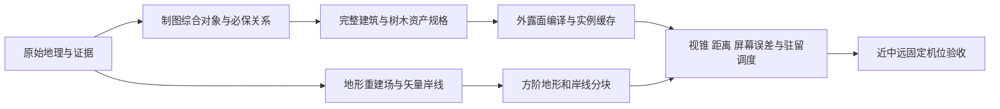

# 重规划：完整体素风格的技术架构建议

日期：2026-10-20。状态：技术规划，未实施新模型、未修改原型或源数据。下列格距、像素阈值、分块与调度参数均为待试制的设计建议，不是已验证的性能指标。

## 1. 先固定交付基线

**每个入选屋舍都具有参考作品级别的完整近景构件。** 普通民居、沿街房和重点节点共享这条基线，区别在建筑类型、组合和识别特征。减少重复民房属于制图综合；把保留下来的房屋做成“墙盒加简顶”，属于细节缺失。

**完整体素风格由方阶形体、构件尺度、外露面、分层轮廓和材料共同形成。** 它允许一个长方体跨越许多0.2米构件格，也允许一个平面用两个共面的三角形提交GPU；它不要求为每格建立独立cube对象。地形表面应呈现柱格顶面和外露竖面，不能用斜三角面山体再叠格纹冒充。

**制图综合、资产精细度和运行优化分成三个系统。**

| 系统 | 决定什么 | 不能替它解决的问题 |
| --- | --- | --- |
| 制图综合 | 哪些屋舍、院落、巷道、水口值得保留，怎样保持方向、疏密和空隙 | 不用统一缩小整个半岛或任意160米方格代替选择与关系设计 |
| 精细资产 | 每个入选对象靠近时看见的构件与地方类型特征 | 不因普通房数量多而降低它们的近景基线 |
| 运行优化 | 哪些块驻留，怎样合面、复用、剔除与切换LOD | 不临时删掉地理对象，不把可见房屋退化成单盒 |

本建议取代旧筹备规范中“0.2米仅用于少数近景对象”的限制。所有入选屋舍均须有完整精细资产；相机靠近时恢复该资产，不通过禁止接近普通房来回避要求。

## 2. 可借鉴的参考机制与需要新增的能力

本地依据：`云山巨城_学习档案/source/云山巨城.html`，以及 `work/architecture-analysis.md`。行号为原参考源码的1基行号。

| 参考代码中的机制 | 已有证据 | 本项目提取方式 |
| --- | --- | --- |
| 0.2米构件单位与snap | 156、160 | 用整数构件单位描述房屋尺寸、门窗、屋檐、台阶和屋顶层 |
| box直接生成表面，Frame组织局部坐标 | 777–835 | 建立有语义的构件图，编译为外表面，不生成全镇占用巨数组 |
| 屋顶分层、檐板、屋脊与翘角 | 980–1057 | 用完整屋顶语法生成近景资产，按地方类型配置，不全套古殿 |
| 1米近地形、2米远地形，顶面与外露侧面 | 340、894–955、3309–3338 | 保留方阶高度场方法；DEM来源与显示格距另外管理 |
| 树干分段、多层叶簇与近远树型 | 2442–2523 | 保留立体盒状层次，补足本项目的分枝与透空验收 |
| 64米分块、近景按需生成、LOD滞回 | 3290–3366 | 提取空间索引、驻留与提交思想，重新实测适合本项目的参数 |
| 屋瓦、石砌、微颗粒由着色器补充 | 2814–2833 | 在已有构件与轮廓上增加材料信息，不能用贴纹补救缺失的檐口、窗洞和台阶 |

参考Frame只有四向旋转，法线仅编码六个轴向；其box也没有完成任意重叠构件的全局内面剔除。这些部分不能直接宣称已解决真实街向、完整实例化或全资产合面，需要另建适配层。

## 3. 数据与显示层分离

建议保留以下逻辑记录，不在本轮创建新数据：

1. **SourceFeature**：真实坐标、原几何、来源ID、时间、高度/类型证据与不确定性，始终保留。
2. **CartographicObject**：入选对象ID、所代表来源、所属街坊/岸侧、必保邻接、显示位置、朝向、院落空隙、选择或移位理由。数量由固定镜头比较决定，不先规定全镇必须压成某个数字。
3. **AssetSpec**：建筑类型、0.2米整数尺寸、构件图、材料方案、确定性seed、全部LOD定义；树木记录树型、主干/分枝与叶簇参数。
4. **InstanceRecord**：稳定ID、assetKey、米制位置、旋转、台基地坪、source/display高度类别；显示移位另列，不能覆盖源位置。
5. **ChunkManifest**：各块引用的对象、地形/水域版本、边界样本、资产依赖、包围盒和LOD状态。

场景继续用米制逻辑坐标，GPU按块使用局部原点，必要时做浮动原点平移。坐标数值变小属于数值处理，不改变对象比例。制图综合若压缩重复空间，应以锚点、街路、岸线和院落关系控制并记录显示变换，不能用一个全局缩放系数同时决定地理、房屋和镜头。

推荐处理链：

## 4. 所有入选屋舍的0.2米构件基线

### 资产内容

每种入选屋舍应具有适合其类型的台基/接地、墙厚、门窗开口与凹槽、檐口和出檐、完整屋顶层次、屋脊/封檐及必要台阶、院墙或栏杆。门窗、檐下和院落通过真实几何产生凹凸与透空；材料纹理只补充瓦缝、砌块和颜色节律。

学校和现代住宅使用其自身结构类型：平顶、女儿墙、楼层/开窗节奏等同样以完整构件完成，不为了体素风格统一套古建筑屋顶。资料只支持类型推定时，记录为类型化设计；标注的“完整细节”指资产完成度，不把推定外观写成现实实测。

### 尺寸与变体

- 规格用0.2米整数单元表达，例如宽度、开间、门洞、台阶和檐出分别参数化。
- 变宽、加开间、加楼层时重新生成并对齐构件；不能靠任意非均匀实例缩放把门、窗、瓦层一起拉伸。
- 建立有限但充分的参数变体库，以屋顶组织、开间、院落/巷侧和材料配方区分对象。seed控制稳定差异，不每次加载重新随机。
- 所有入选对象必须能解析到L0完整资产。远景批次不持有唯一一份简盒模型。

### 编译与节省几何

1. 先输出有语义的盒体、开口和少量阶梯截面，不逐cube创建场景节点。
2. 在单资产或小子块内部，用临时有界占用、稀疏行区间或盒体面裁切求外露面；删除完全埋入墙/屋顶的不透明内面。透明窗、开口和独立细构件按材料规则处理，不能误删洞口。
3. 同平面、同材质、同AO/光照条件的相邻面做行合并或二维greedy合并。屋顶阶差、檐口和窗洞边界属于必须保留的几何边界。
4. 依据构件/材料组织结构和细节子网格，上传紧凑顶点、索引与材质标记。合面后的表面颗粒采用稳定局部坐标，避免大面拉伸纹理。
5. 相同assetKey/LOD/材料管线的完整网格实例化；实例参数主要是平移、旋转、配色和seed。跨多块的大院落保留统一对象ID和实际包围盒，再组织提交，避免重复绘制。

这是“完整模型的低成本提交”，不是把完整房屋替换成独立墙盒。

## 5. 网格方向：地形统一轴，建筑随真实街向

**建议采用混合坐标架构。** 地形柱格采用统一东西/南北轴；每栋建筑与树木资产采用自己的0.2米局部轴，整体绕y轴旋转到经审查的街向或建筑方向。所有构件仍是局部方块和方阶，不能为保持全球同一格线而把房屋朝向强行归为四个方向。

这意味着“每个资产内部0.2米对齐”，不宣称所有旋转资产都落在同一张全镇0.2米世界格网上。建议在美术规则中明确接受这项取舍。

技术上，六轴法线可以在资产局部编码，但实例着色必须用旋转矩阵/实例角度转到世界空间；光照、阴影和AO的坐标也应一致。自由角度批处理时不能继续把法线当作世界六轴。

房屋与地形交界独立生成0.2米台基、台阶/护坡和必要门前铺地，保住真实街侧、岸侧与入口关系。斜向道路可按路径生成有宽度的占用走廊，再在其边缘产生方阶，而不是强制整个村路只走世界x/z方向。

若未来选择严格全球轴对齐的艺术方向，则需要重新综合街坊和道路，并记录改向与位移；不能在真实街向方案上悄悄叠加四向归整。两种方案先做同机位小样再择一，本建议优先保留街向的局部网格方案。

## 6. 地形：来源30米，显示1–2米柱格

### 三层高度必须分别保留

| 层 | 内容 | 精度含义 |
| --- | --- | --- |
| H_source | 原始1角秒DSM及质量层、EGM2008、来源日期 | 本地区约26.5×30.8米采样，含建筑/植被；它约束可信地形信息 |
| H_reconstructed | 从源样本重建的连续宏观高度场与有证据的控制点 | 插值改善显示连续性，不增加实测细节；峰谷及重要剖面另做对照 |
| H_display | 从重建场生成的柱格高度、台基与经过记录的表现编辑 | 1–2米是显示格距，0.2–1米可作为待试制的垂直阶级；均非实测精度 |

不再先把源DSM降为100米最近邻作为所有近景的唯一高度。基础重建应能在源采样位置回读原高程；显示柱格的峰顶、山脊与剖面应与源样本对比。原始DSM无法支持的街坡、护岸、台基地坪另记为推定或待核，不能用细柱格掩盖资料缺口。

### 表面构造

- 可接近地段建议1米柱格，普通近景建议2米；更远地形可试4/8米分级，但仍输出平顶格和竖向阶面，不能切成光滑斜三角山体。
- 每个柱格只生成顶面和相邻较低格旁的外露竖面。同高同材质连续顶面合并，高侧面可用整块矩形面，不从基底到顶部逐立方体堆叠。
- 以64米或128米逻辑块作首轮试制候选；采用2的整数幂格距，并共用块边界样本、边缘约束和过渡带。接缝不能跨过必保岸口或道路，以裙边隐藏裂缝也不能遮住真实岸口。
- 只为相机附近与预取环生成精细柱格；全镇保留源瓦片、重建函数和块索引，不常驻全镇1米几何，更不保存全镇0.2米三维占用阵列。
- 地形显示表面与建筑、道路、树根的落地查询使用同一版H_display；地坪编辑后必须使关联网格和高度缓存同步失效。

## 7. 岸线与水口：矢量控制，局部细分

1. 把选定的湖岸、岛缘、港道、水口、桥头作为独立必保边界，并保留来源/时间。水位另列基准和显示用途，不能把镇江吴淞基面值直接赋给EGM2008。
2. 地形柱格在岸线附近用格中心分类、几何覆盖比例或裁切覆盖计算；**禁止用100米ALL_TOUCHED把接触格整格侵蚀为水域。**
3. 岸线周围建立局部细分带，首轮可试0.5–1米边缘单元，与内陆1–2米柱格共享整数嵌套坐标。用阶梯边缘逼近来源矢量，在保留格的水侧生成方阶岸壁与岸顶，水面只填水侧。阶梯是显示形状，不伪称来源具备0.5米精度。
4. 对宽度小于当前格距几倍的重要港口、巷边水道，优先再细分；确需为可读性加宽时单列显示宽度与来源宽度，保持桥下、入湖、岸侧关系。不能因粗格容纳不下就堵口或删口。
5. 远景岸线可以减少阶梯段，但保留岛孔、主湾转折与必保水口。陆地网格和水面由同一边界版本派生，避免一套12米水面与另一套100米地面各自形成岸线。

岸线验收量测的是“显示方阶对选定矢量的偏差”，不是对现实岸线的绝对精度。候选目标可设为不超过约1.5个边缘显示格，明确的制图夸张另行审查；最终阈值由局部样区比较确定。

## 8. 树木：主干、分枝、分层叶簇贯穿近远景

**近景树型资产**至少包含主干延续、分枝方向、主次叶簇、冠缘凹凸和可透视的枝叶空隙。枝条以短段方柱/阶梯盒连接，叶簇以有上下层次和颜色层次的小盒搭接。松、阔叶、柳、果树/园林类在冠形、分层与主枝上有稳定差异；土地覆盖只有大类时，具体树种配置记录为类型化表达。

**中景**允许合并叶簇内面和减少细枝，但保留主干、主分枝、冠层台阶与透空；不能变成几根杆加规则大方冠。**远景**合并邻近同型冠层时仍保留起伏的多层方块外轮廓、树型差异和林缘空隙；不能退成icosphere、圆锥、圆球、平板照片或一整块平冠。

按有限树型/变体的完整网格做实例化，实例随空间块管理；树林先使用用地、道路、房屋、院落与水域占用约束，再布树。随机seed稳定，加载块或切换LOD不能改变树位。树根、道路净空、院落留空和岸口是独立验收项。

## 9. LOD与运行调度：减少提交，不降近景基线

建议把LOD选择建立在屏幕投影尺寸、关键构件可见度和距离之上。以下只是首轮试制阈值，必须在固定分辨率/FOV下校准：

| 级别 | 候选触发 | 必须保留 |
| --- | --- | --- |
| L0完整资产 | 建筑投影高度约80px以上，或门窗/檐口关键构件已达约1–2px，或用户选中/进入近看 | 完整构件图、真实凹槽与透空、檐下、台基、屋脊/封檐；所有入选屋舍同一基线 |
| L1结构资产 | 建筑投影高度约20–80px | 体量组合、开间节律、主门窗洞、檐口/屋脊、院落空隙与主枝/冠层；可移除亚像素雕饰 |
| L2轮廓资产 | 建筑约20px以下 | 多体量屋顶、出檐、屋脊和主要负空间；保持3D方阶轮廓与同一对象身份，不能换成一个盒子 |

近景恢复用提前预取和约15%–25%的切换滞回作为候选。旧LOD在新LOD完整可用前继续显示，避免空块和半栋房；进入精细范围应优先完成目标资产加载，不能以长期停留粗盒或锁死近看距离作为解决办法。

运行优化顺序：

1. 先剔除未入视锥/被遮挡的块和不可见表面；用实际包围盒处理跨块对象。
2. 按完整资产实例批次提交，静态块网格缓存；各对象的LOD切换避免细节体与远景体叠画。
3. 在Worker中做纯几何生成/外露面编译，主线程限量上传；每帧生成与上传预算由测量确定，不预先承诺“每帧多少块即流畅”。
4. CPU/GPU缓存用版本键和LRU释放；返回片区时复用资产、位置与seed。提供明确释放与上下文恢复路径。
5. 性能不足先缩减远距阴影、透明叠层、后处理与DPR，再调预取/驻留范围；关键近景构件保留。建筑数量的艺术取舍在离线综合层确定，不随瞬时帧率改变。
6. 分别记录生成、上传、主pass、阴影、透明pass、CPU/GPU驻留和冷/热加载结果。帧率与目标设备、视口、FOV、镜头、场景密度一起报告。

## 10. 硬性禁止项

- 用TIN或光滑三角山体加格纹代替可见柱格顶面/竖面；用一层像素滤镜宣称完成体素风格。
- 把普通入选房屋降为墙盒加简顶；只为地标制作近景细节；靠相机最近距离掩盖缺失资产。
- 房屋/树木按每个cube建立独立场景对象或draw call；承诺全镇0.2米稠密三维存储。
- 将0.2米构件格、1米显示柱格或细分岸线写成东山实测精度；把DSM当裸地测量面。
- 用100米水陆掩膜侵蚀海岛/湖岸；仅按单段长度删水路；以粗格最近空格自动跨街、跨水移房。
- 用固定160米方格和全镇统一压缩比例代替街坊、院落、临水/沿街关系的制图综合。
- 树冠使用icosphere/球体/圆锥；远景统一平冠；切换LOD改变树位或建筑身份。
- 为适配实例化任意拉伸房屋构件格，或将真实街向无记录地归成四向；自由旋转资产却仍用世界六轴法线计算光照。
- 用浓雾、压暗、俯瞰距离或标注遮挡掩盖几何不完整；把数组/哈希/计数检查称为视觉验收。
- 用点位、校园边界或园区边界冒充具体主楼平面；把未知布局补成“真实还原”。

## 11. 阶段产物与验收门槛

| 阶段 | 交付产物 | 进入下一阶段前的验收 |
| --- | --- | --- |
| A. 规格冻结 | 入选对象与必保关系表；构件图；坐标/网格/高度定义；固定镜头卡 | 确认每个入选屋舍均有L0路线，综合与LOD职责分开；尚不扩全镇 |
| B. 单体试制 | 普通民居、沿街房、现代学校类型的完整样件；若干体素树型；资产参数与证据表 | 同等屏幕占比与参考近景并排比较，正/背/侧/俯视能检查台基、墙厚、真门窗、檐下、屋顶层次和树枝叶空隙 |
| C. 关系样区 | 一段沿街/临水聚落，含代表院落、桥/水口、细阶岸线与地形块边界 | 实走近看路径；逐项核对街侧/岸侧、巷院负空间、桥水关系、房树比例、落地与块缝；不能只验一张全景 |
| D. 多尺度样区 | 同一批对象的L0/L1/L2、缓存/预取与阴影分级；测量记录 | 连续推进/后退录像；近景基线完整，无变盒、漂移、重叠与空块，远景仍有可辨方阶轮廓；实测提交与驻留 |
| E. 全域扩展 | 半岛+三山岛分块索引、稳定对象ID、分区内容清单、验证镜头组 | 各片区和每种资产/参数变体通过近中远检查；随机选入选屋舍靠近验证L0；全域视图复核轮廓、密度、主路与水口 |

单体机位建议同时采用约1.5–1.8米眼高的接近路径和等屏幕占比的正/侧/背/俯视转台；这些是验收机位，不把镜头限制在看不见细节的位置。比较时先关闭浓雾与强后期，用正常日光和统一FOV/分辨率检查，再验夜景和氛围。

自动检查覆盖所有对象的assetKey/L0存在性、0.2米参数对齐、LOD身份、必需构件/开口记录、边界样本、数据来源与移位记录；视觉检查覆盖每个资产族、实际参数变体及片区布置。程序通过不能替代材质、轮廓与比例审查。

地形验收应同时保留源样本点、源剖面、重建剖面和显示阶梯剖面；岸线验收叠加来源矢量、显示阶梯和水口连接；聚落验收对比原足迹覆盖、显示屋舍覆盖、方向分布与巷院空隙，不能只用“代表了多少栋”证明密度保住。

各阶段分别记录“数据校验通过”“几何结构通过”“视觉与比例通过”“运行测量完成”。本轮交付仅为本技术建议，不包含上述样件或性能验证。
