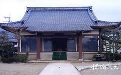

# 法海寺

资料对象为苏州东山法海寺，官方文保名录仅确认东山镇、清代古建筑、市级文物保护单位。本批保留OSM候选点位及一张正面照候选；二手资料的西坡记述与OSM点相对峰顶的方位不一致，点位、文保本体和照片尚未完成对应核验。

## 位置

- WGS84（经度、纬度）：120.3918743, 31.0950032。
- 位置角色：OSM node/13800863490寺庙标签候选点；尚未核定对应文保本体、山门或大殿中心；可信范围：中低：OSM点可追溯，但与二手西坡记述存在方位冲突；官方名录不足以验证这一具体点位。
- 地址：江苏省苏州市吴中区东山镇（官方名录精度；具体山坡、门牌未核定）。
- 项目已有2026-10-19 OSM快照将其标为amenity=place_of_worship、religion=buddhist。
- 官方文保名录地址精度到东山镇；相约久久记述西坡下法海坞，不能据此直接给OSM点赋西坡地址。
- 本地莫厘峰峰顶OSM node/13800809445为[120.3894991,31.1003028]；法海寺候选点相对该峰顶约向东226米、向南588米，属于东南方向，与二手西坡字面记述不一致。
- 本轮未找到可解释该冲突的带坐标官方寺址、现场导览图或可配准影像；山域名称差异、地名沿革或OSM误标均未证实，不任选一种解释。
- 本条不采用北京石景山法海寺、福州法海寺、青岛法海寺的图文。
- 不把相传隋代创寺视为现存殿宇建造年代。

## 客观信息

- 苏州市文化广电和旅游局文物保护单位名录：法海寺，市保，吴中区，清代，东山镇，公布日期1986年3月25日，类型古建筑。（2026-10-23；[苏州市各级文物保护单位名录（法海寺，第156项）](https://wglj.suzhou.gov.cn/szwhgdhlyj/whbf/list_tt.shtml)）

- 相约久久苏州东山景区法海寺图文页将该寺置于莫厘峰西坡下法海坞，并讲述隋代莫厘将军舍宅建寺的传说；本批仅将其作为地理和历史线索。（资料日期未明；[苏州东山景区旅游攻略之法海寺（图文）](https://www.meet99.com/jingdian-suzhoudongshan-25989.html)）

- 低分辨率图像可见灰瓦坡屋顶、外露檐部、红褐色门柱、居中的门洞与前部台阶；只能辅助外观研究，不能据此量取尺寸或确认全寺布局。（2026-10-23；[苏州东山景区旅游攻略之法海寺（图文）](https://www.meet99.com/jingdian-suzhoudongshan-25989.html)）

- OSM点标明佛教礼拜场所；官方风景资源介绍亦列举东山现存法海寺。（2026-10-23；[法海寺：OpenStreetMap node 13800863490](https://www.openstreetmap.org/node/13800863490)、[东山景区（太湖风景名胜区资源版）](https://zyb.taihufengjing.com/Article?Id=7da48b2f-da3d-48f2-bba3-d10e1acb9aac)）

- 按本地WGS84坐标比较，法海寺候选点位于莫厘峰峰顶标签点东南约630米；向东约226米、向南约588米。该计算只描述两个OSM点的相对方位，不判断哪一来源正确。（2026-10-23；[法海寺：OpenStreetMap node 13800863490](https://www.openstreetmap.org/node/13800863490)、[莫厘峰：OpenStreetMap node 13800809445（仅作方位核对）](https://www.openstreetmap.org/node/13800809445)）

## 参考图

### 法海寺正面照候选（低分辨率）

- 类型/验证：殿宇正面，拍摄方位和日期未知；已下载、已目视；页面地点标签匹配，未用地面标志或坐标独立验证。
- 图片由明确标注苏州东山法海寺的图文页链接，文件242×150像素。
- 可见灰瓦坡屋顶、红褐门柱、中央门洞、台阶及两侧植被。
- 图片存在网站水印；低分辨率不足以可靠读匾额、分析斗拱或认定现存建筑年代。
- [来源页面](https://www.meet99.com/jingdian-suzhoudongshan-25989.html) · [原图](https://i.meet99.cn/image/19/59/69af1beec34b7bd53264718904bc.jpg)。
- 权利状态：未见开放许可；保留来源和水印，仅内部研究参考，不作为公开贴图或再分发素材。

### 法海寺香花桥现场照片候选

- 类型/验证：寺周边香花桥；待打开核验；仅索引候选；web抓取超时，普通HTTPS请求证书名称/链错误，未绕过验证。
- 搜索索引明确题为吴中区东山镇法海寺香花桥，并列两幅图片。
- 页面索引称桥初为明代所建、现为新建；本批未获得可目视图像，不写入实证外观。
- [来源页面](https://www.china-qiao.com/ql16/szql/szql649.htm)。
- 权利状态：版权未核定；候选链接备用。

## 待补

- 优先核验位置冲突：二手图文的莫厘峰西坡下法海坞，与OSM候选点相对峰顶位于东南不一致。需官方寺址或文保范围图、现场带定位照片等建立同一性，当前点位不得直接作为已确认法海寺落模锚点。
- 官方精确地址、院落边界、山门／主殿锚点、主轴方向和殿宇尺寸。
- 现状多角度高清照片、拍摄年份，以及低分辨率照片所示殿宇与现存主殿的对应。
- 香花桥、泉池、寺与周边墓区的现状空间关系；不能用古代繁盛描述复原当代建筑群。
- 文保本体与寺庙登记/开放状态的完整官方说明。

[返回资料目录](../index.html#fahai-temple)
