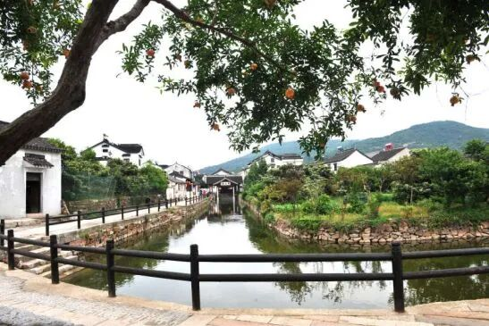
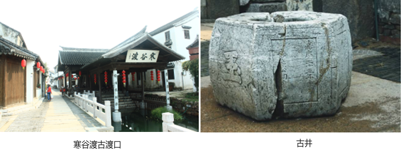
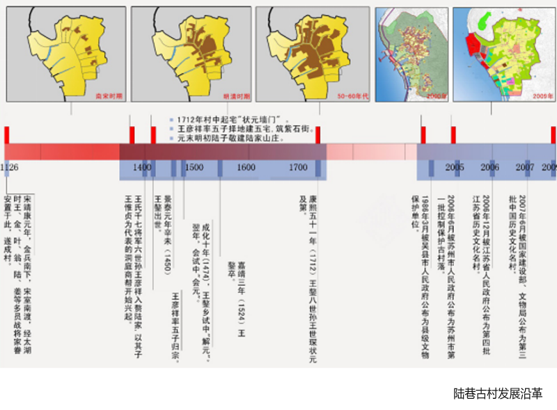

# 寒山港

陆巷古村港道，地方志有明确题注实景。新增街巷水岸格局图与寒谷渡照片，可补充港道、村落、湖岸的相对关系；“寒山浜”名称与全线对应关系仍需核定。

## 位置

- WGS84（经度、纬度）：暂未取得可靠数值坐标。
- 位置角色：港道线／水面及岸线；坐标和全线待核；可信范围：题注实景与村级归属可靠；全线/入湖接口待核。
- 地址：江苏省苏州市吴中区东山镇陆巷古村。
- 2026地方志题注为“寒山港”；2020规划摘要列三条古河道时用“寒山浜、陆巷浜、蒋湾浜”。两种名称相近，但本次未取得地名管理或测绘资料证明其全线严格等同。
- 2019论文图1北部蓝色港道标为寒山港（小字），并在村西侧接湖岸水系；仅可用于示意相对关系。
- 寒谷渡是附近古渡口/亭景的独立对象，不把渡口点直接当港道入口坐标。

## 客观信息

- 地方志描述陆巷有三条港道向西汇入太湖，与一街六巷共同构成古村格局；正文并配有题注“寒山港”的照片。（2026-09-24；[古镇古村系列——吴中区陆巷村：太湖明珠，宰相故里](https://dfzb.suzhou.gov.cn/dfzb/szdq/202609/74f82b260f3045e79aeb1cb2c5d0d15d.shtml)）

- 规划摘要列三条古河道为寒山浜、陆巷浜、蒋湾浜，并列寒谷渡、陆巷渡、蒋湾渡三个古渡口。（2020-08-21；[苏州市东山镇陆巷村陆巷](https://www.c-dwellings.com/news_detail.php?id=380)）

- 寒山港题注照片可见石驳岸、窄水道、步道护栏、临水建筑和后方山体；只是一个视段。（影像拍摄日期未注明；[古镇古村系列——吴中区陆巷村：太湖明珠，宰相故里](https://dfzb.suzhou.gov.cn/dfzb/szdq/202609/74f82b260f3045e79aeb1cb2c5d0d15d.shtml)）

- 论文记2007年整治中疏浚寒山港，并绘村落水岸格局；这些资料只说明历史整治与相对水系，未给现状水位或断面。（2019-12；[社区参与模式下的传统村落旅游空间生产及影响初探——基于苏州东山陆巷古村的调研](https://faculty.ecnu.edu.cn/_upload/article/files/71/c0/cdbcd566457b8af90879d23f0447/dcad72f2-4050-4e57-93ad-e668ac1c7f50.pdf)）

- 新增图中寒谷渡临水亭廊、栏杆和沿水步道可作邻近水岸构件参考；不能替代寒山港全线现状照片。（影像拍摄日期未注明；[苏州市东山镇陆巷村陆巷](https://www.c-dwellings.com/news_detail.php?id=380)）

## 参考图

### 寒山港

- 类型/验证：题注寒山港的港道局部；2026-10-23复核来源页并重新目视本地原图；复用旧参考包，不重复下载。。
- 可见港道、石驳岸、两岸步道与民居、远处山体。
- 用于水道—岸线—房屋的关系；不据单幅照片推断港道全线。
- [来源页面](https://dfzb.suzhou.gov.cn/dfzb/szdq/202609/74f82b260f3045e79aeb1cb2c5d0d15d.shtml) · [原图](https://dfzb.suzhou.gov.cn/dfzb/szdq/202609/74f82b260f3045e79aeb1cb2c5d0d15d/images/2e1d73198ab543ac92fa2ff4ec340227.png)。
- 权利状态：未确认开放许可；保留原署名/水印，仅作内部研究参考，不据此视为可公开贴图或再分发。。

### 寒谷渡与古井（组合图）

- 类型/验证：左为寒谷渡临水亭廊；右为古井；2026-10-23已核对来源上下文、下载原图并目视检查；无登录/错误页。。
- 左图屋面山墙处可读“寒谷渡”，可见临水亭廊、护栏、石板步道与水面。
- 右为古井近景，原图组合不提供其与港道的精确距离；不能把古井或渡口自动吸附到港道端点。
- [来源页面](https://www.c-dwellings.com/news_detail.php?id=380) · [原图](https://www.c-dwellings.com/images/article/237_content_1598006520419909.png)。
- 权利状态：未确认开放许可；保留原署名/水印，仅作内部研究参考，不据此视为可公开贴图或再分发。。

### 陆巷聚落演变示意图与历史时间轴

- 类型/验证：聚落演变图组；2026-10-23已核对来源上下文、下载原图并目视检查；无登录/错误页。。
- 图组概示聚落、湖侧水道与道路在历史阶段中的关系；最右两幅标2000年前、2009年。
- 图很小且有时序概化，不以其恢复寒山港现状岸线或精确拓扑。
- [来源页面](https://www.c-dwellings.com/news_detail.php?id=380) · [原图](https://www.c-dwellings.com/images/article/237_content_1598005311818937.png)。
- 权利状态：未确认开放许可；保留原署名/水印，仅作内部研究参考，不据此视为可公开贴图或再分发。。

### 陆巷古村“一街六巷”格局与商业分布（论文图1，完整第160页）

- 类型/验证：PDF第5页渲染；图1及上下文；2026-10-23下载PDF；用Poppler渲染并目视完整第1页和第5页，核实标题、作者、图1、北箭头及比例尺。。
- 图1有北箭头和0–150 m比例尺；红线标一街六巷，蓝线标水岸，橙线为环山公路。
- 可辨紫石街、文宁巷、康庄巷及惠和堂位置；村落西侧为太湖，三个港道分别通向湖侧。
- 这是2019论文中的示意地图，未给CRS、基准点或测绘精度；可做历史相对空间关系，不输出精确WGS84线形。
- [来源页面](https://faculty.ecnu.edu.cn/_upload/article/files/71/c0/cdbcd566457b8af90879d23f0447/dcad72f2-4050-4e57-93ad-e668ac1c7f50.pdf)。
- 权利状态：未确认开放许可；保留原署名/水印，仅作内部研究参考，不据此视为可公开贴图或再分发。。

## 待补

- 寒山港与寒山浜的地名对应、法定起讫及全线范围。
- 水道与太湖的实际连通接口、桥涵/闸口、现状岸线和中心线。
- 可靠的坐标系、断面宽度、水位及岸顶高度。
- 从港内向湖侧、从湖口向村内的成组实景和桥涵特写。

[返回资料目录](../index.html#hanshan-port)
