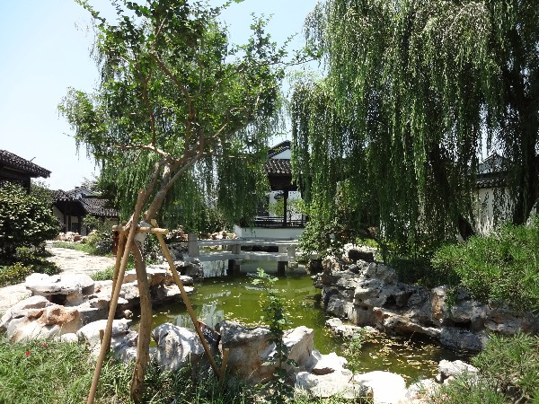
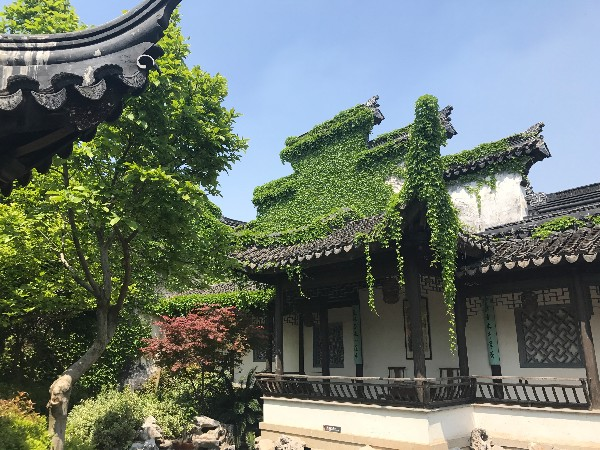
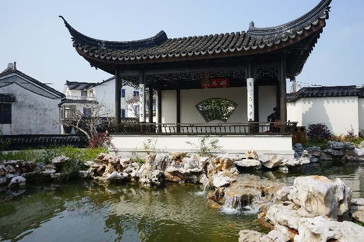
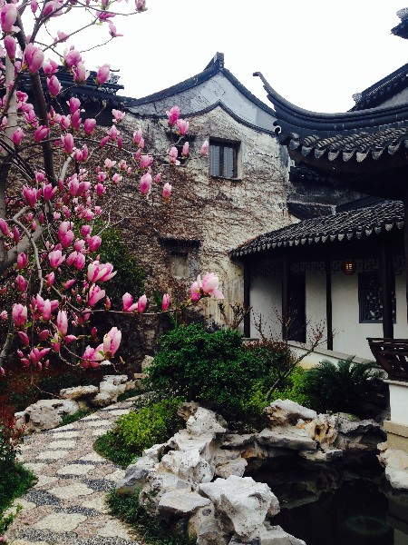
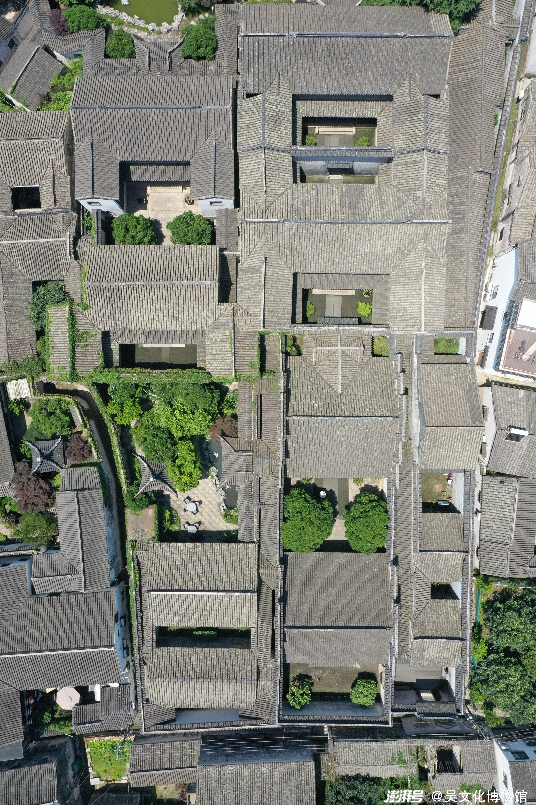
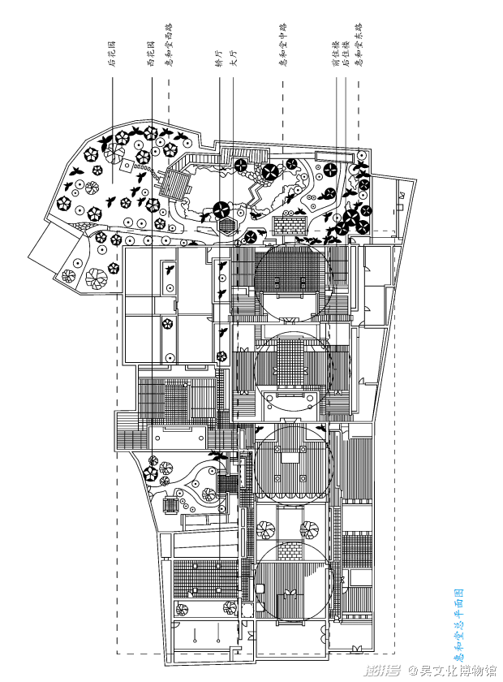
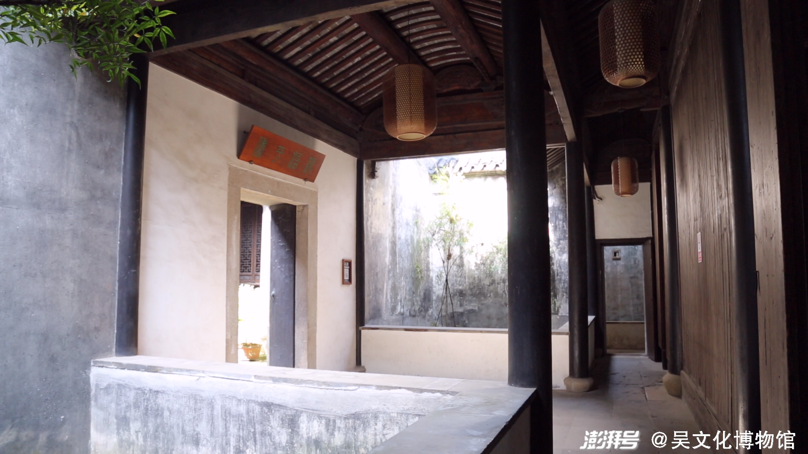
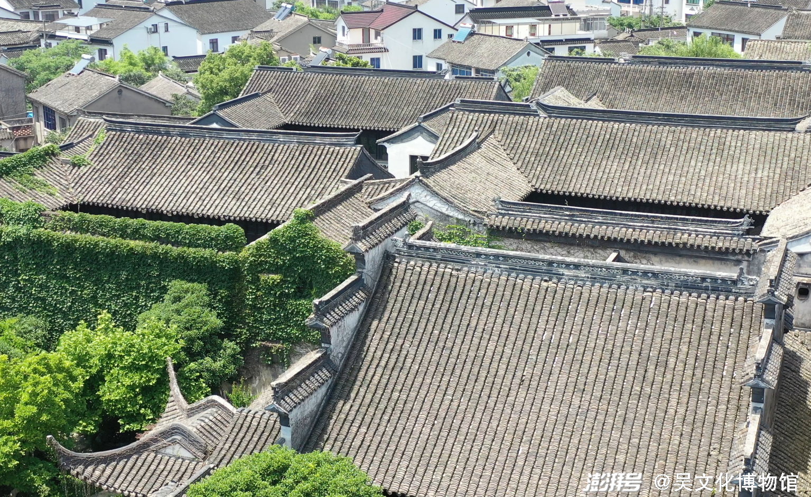
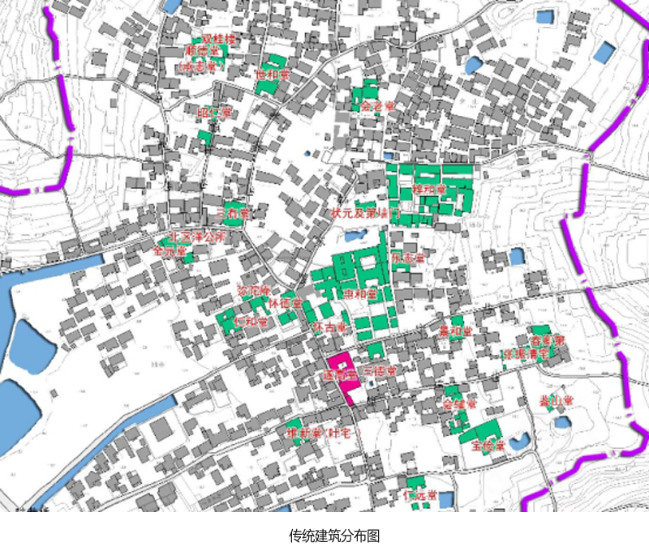

# 惠和堂

位于东山镇陆巷古村文宁巷内，坐北面南，三路五进的大型厅堂宅园。已取得来源明确的平面图、俯瞰、局部书楼与园林参考。

## 位置

- WGS84（经度、纬度）：暂未取得可靠数值坐标。
- 位置角色：建筑群；当前以文献地址和相对空间关系定位；可信范围：地址与朝向有机构文字支持；地理坐标/占地界线待核。
- 地址：江苏省苏州市吴中区东山镇陆巷村文宁巷内。
- 吴文化博物馆文字明示文宁巷及坐北面南；机构来源足以支持朝向，区别于从照片推测。
- 论文图1将惠和堂标在紫石街东侧、文宁巷附近；住建厅主办网站的传统建筑分布图亦标出惠和堂及邻近怀古堂。
- 两张分布图和旧平面/俯瞰均无可用CRS，未把示意图坐标或像素坐标转写成经纬度。

## 客观信息

- 官方园林名录认定为王鏊故居；现为王鏊纪念馆。（2025-10-20；[惠和堂](https://ylj.suzhou.gov.cn/szsylj/ylml/201912/d3d1a3a77c9d40acaa97f641111d8481.shtml)）

- 园林名录给出占地5000平方米、建筑面积3000平方米，三路五进；这些是文字资料面积，非本次量测。（2025-10-20；[惠和堂](https://ylj.suzhou.gov.cn/szsylj/ylml/201912/d3d1a3a77c9d40acaa97f641111d8481.shtml)）

- 宅院坐北面南，高墙围合；分东、中、西三路，各进以天井相隔，路间有备弄相通。（2021-11-23；[吴县繁华如许｜遍览世间乐土：自适与宅院](https://www.thepaper.cn/newsDetail_forward_15501667)）

- 中路为轿厅、大厅、前后住楼；西路有客房、花厅与书楼，东路有门第、仆房、账房等。（2021-11-23；[吴县繁华如许｜遍览世间乐土：自适与宅院](https://www.thepaper.cn/newsDetail_forward_15501667)）

- 书楼名静观楼，在西路第三进；正厅与前住楼之间用穿堂和两方蟹眼天井组织空间。（2021-11-23；[吴县繁华如许｜遍览世间乐土：自适与宅院](https://www.thepaper.cn/newsDetail_forward_15501667)）

- 论文图1及传统建筑分布图可互证惠和堂、文宁巷、紫石街的相对关系；这不是已验证的现状坐标。（2019–2020文献图件；[社区参与模式下的传统村落旅游空间生产及影响初探——基于苏州东山陆巷古村的调研](https://faculty.ecnu.edu.cn/_upload/article/files/71/c0/cdbcd566457b8af90879d23f0447/dcad72f2-4050-4e57-93ad-e668ac1c7f50.pdf)、[苏州市东山镇陆巷村陆巷](https://www.c-dwellings.com/news_detail.php?id=380)）

## 参考图

### 惠和堂后花园池石与小桥

- 类型/验证：园内局部实景；2026-10-23复核来源页；旧参考包已有逐图目视与SHA审计，复用原文件。。
- 可见园池、叠石、小桥、廊亭、树木。
- 用于园林水石植被关系，允许合并小构件。
- [来源页面](https://ylj.suzhou.gov.cn/szsylj/ylml/201912/d3d1a3a77c9d40acaa97f641111d8481.shtml) · [原图](https://ylj.suzhou.gov.cn/szdoc/szsylj/uploadfile/rzke5cfu3p5.jpg)。
- 权利状态：未确认开放许可；保留原署名/水印，仅作内部研究参考，不据此视为可公开贴图或再分发。。

### 惠和堂园内廊檐与山墙

- 类型/验证：园内局部实景；2026-10-23复核来源页；旧参考包已有逐图目视与SHA审计，复用原文件。。
- 可见灰瓦屋面、山墙轮廓、木栏与植物攀覆。
- 优先提取屋顶/山墙轮廓；攀覆植物不等同永久建筑形态。
- [来源页面](https://ylj.suzhou.gov.cn/szsylj/ylml/201912/d3d1a3a77c9d40acaa97f641111d8481.shtml) · [原图](https://ylj.suzhou.gov.cn/szdoc/szsylj/uploadfile/acudlphvdmd.jpg)。
- 权利状态：未确认开放许可；保留原署名/水印，仅作内部研究参考，不据此视为可公开贴图或再分发。。

### 惠和堂池边亭廊

- 类型/验证：园内局部实景；2026-10-23复核来源页；旧参考包已有逐图目视与SHA审计，复用原文件。。
- 可见开敞柱间、飞檐、栏杆、池岸叠石。
- 可压缩为檐顶、立柱、栏杆和池岸四类体块。
- [来源页面](https://ylj.suzhou.gov.cn/szsylj/ylml/201912/d3d1a3a77c9d40acaa97f641111d8481.shtml) · [原图](https://ylj.suzhou.gov.cn/szdoc/szsylj/uploadfile/152brnbggul.jpg)。
- 权利状态：未确认开放许可；保留原署名/水印，仅作内部研究参考，不据此视为可公开贴图或再分发。。

### 惠和堂园内墙檐与花木

- 类型/验证：园内局部实景；2026-10-23复核来源页；旧参考包已有逐图目视与SHA审计，复用原文件。。
- 可见连续墙檐、山墙、叠石、铺地与开花植物。
- 供局部材质和植物点景参考，拍摄季节未确认。
- [来源页面](https://ylj.suzhou.gov.cn/szsylj/ylml/201912/d3d1a3a77c9d40acaa97f641111d8481.shtml) · [原图](https://ylj.suzhou.gov.cn/szdoc/szsylj/uploadfile/gxiiofr3q5p.jpg)。
- 权利状态：未确认开放许可；保留原署名/水印，仅作内部研究参考，不据此视为可公开贴图或再分发。。

### 惠和堂俯瞰

- 类型/验证：俯瞰；非正射测绘；2026-10-23复核来源页并重新目视本地原图；复用旧参考包，不重复下载。。
- 清楚显示多路院落、天井、屋顶和侧园；图有吴文化博物馆水印。
- 可提取相对布局、轮廓和粗略长宽关系；无坐标、比例尺，不是正射测绘成果。
- [来源页面](https://www.thepaper.cn/newsDetail_forward_15501667) · [原图](https://imagepphcloud.thepaper.cn/pph/image/165/326/596.jpg)。
- 权利状态：未确认开放许可；保留原署名/水印，仅作内部研究参考，不据此视为可公开贴图或再分发。。

### 惠和堂平面图

- 类型/验证：院落平面图；无尺寸链/比例尺；2026-10-23复核来源页并重新目视本地原图；复用旧参考包，不重复下载。。
- 平面线条、院落和部分建筑标注可读；图有吴文化博物馆水印。
- 可读院落关系，未见尺寸链、坐标和比例尺；不作为精确测绘图。
- [来源页面](https://www.thepaper.cn/newsDetail_forward_15501667) · [原图](https://imagepphcloud.thepaper.cn/pph/image/165/326/602.png)。
- 权利状态：未确认开放许可；保留原署名/水印，仅作内部研究参考，不据此视为可公开贴图或再分发。。

### 惠和堂穿堂

- 类型/验证：穿堂、天井与廊道；2026-10-23复核来源页；旧参考包已有逐图目视与SHA审计，复用原文件。。
- 清楚显示木柱、廊道、天井留空、墙面和室内外关系；图有博物馆水印。
- 用于体块留空、材质和穿堂关系，不要求逐件建模。
- [来源页面](https://www.thepaper.cn/newsDetail_forward_15501667) · [原图](https://imagepphcloud.thepaper.cn/pph/image/165/326/639.png)。
- 权利状态：未确认开放许可；保留原署名/水印，仅作内部研究参考，不据此视为可公开贴图或再分发。。

### 惠和堂书楼附近屋顶与院落斜俯视

- 类型/验证：斜俯视局部；2026-10-23已核对来源上下文、下载原图并目视检查；无登录/错误页。。
- 原页面题注为惠和堂书楼；可见高低错落的瓦屋顶、山墙和院内藤蔓。
- 图带吴文化博物馆水印，无比例尺；拍摄日期和镜头方向未明，不从画面量测高度或真北。
- [来源页面](https://www.thepaper.cn/newsDetail_forward_15501667) · [原图](https://imagepphcloud.thepaper.cn/pph/image/165/326/659.png)。
- 权利状态：未确认开放许可；保留原署名/水印，仅作内部研究参考，不据此视为可公开贴图或再分发。。

### 陆巷传统建筑分布图

- 类型/验证：带地形和建筑底图的传统建筑分布图；2026-10-23已核对来源上下文、下载原图并目视检查；无登录/错误页。。
- 惠和堂、怀古堂、三有堂、宝俭堂等以文字和着色建筑范围标出；可查相对位置与院落轮廓。
- 底图有港道和街巷，但无可读坐标、北箭头或比例尺；原图字形小，不能当精确地籍边界。
- [来源页面](https://www.c-dwellings.com/news_detail.php?id=380) · [原图](https://www.c-dwellings.com/images/article/237_content_1598005940998250.png)。
- 权利状态：未确认开放许可；保留原署名/水印，仅作内部研究参考，不据此视为可公开贴图或再分发。。

### 陆巷古村“一街六巷”格局与商业分布（论文图1，完整第160页）

- 类型/验证：PDF第5页渲染；图1及上下文；2026-10-23下载PDF；用Poppler渲染并目视完整第1页和第5页，核实标题、作者、图1、北箭头及比例尺。。
- 图1有北箭头和0–150 m比例尺；红线标一街六巷，蓝线标水岸，橙线为环山公路。
- 可辨紫石街、文宁巷、康庄巷及惠和堂位置；村落西侧为太湖，三个港道分别通向湖侧。
- 这是2019论文中的示意地图，未给CRS、基准点或测绘精度；可做历史相对空间关系，不输出精确WGS84线形。
- [来源页面](https://faculty.ecnu.edu.cn/_upload/article/files/71/c0/cdbcd566457b8af90879d23f0447/dcad72f2-4050-4e57-93ad-e668ac1c7f50.pdf)。
- 权利状态：未确认开放许可；保留原署名/水印，仅作内部研究参考，不据此视为可公开贴图或再分发。。

## 待补

- 可靠的WGS84/CGCS2000锚点或已明确坐标系的地图POI。
- 现状建筑群围墙/占地界线、入口精确位置。
- 各单体高度、屋脊标高与尺寸链。
- 俯瞰/平面图与2026现状的一致性，尤其园林及附房变化。

[返回资料目录](../index.html#huihetang)
