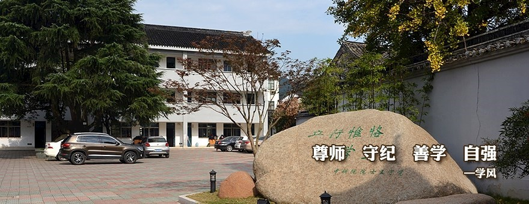
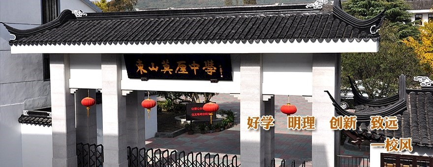
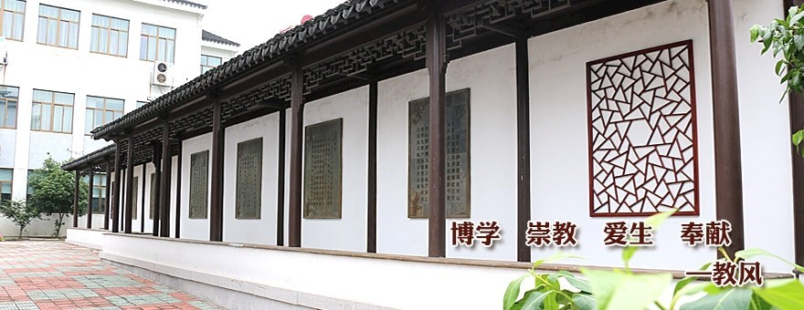
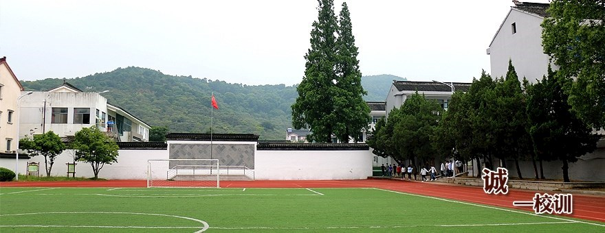

# 莫厘中学

位于东山镇人民街62号的初中校园。官方站点提供校门、教学楼庭院、木廊和运动场的实景照片；白墙、深色瓦屋面、园林式院墙与背后的山体是照片中可辨认的视觉要素。

## 位置

- WGS84（经度、纬度）：120.3973049, 31.0842676。
- 位置角色：OpenStreetMap学校用地多边形的面积质心；可信范围：中：官网确认学校及地址，坐标和地块边界来自公众协作地图，未作测绘核验。
- 地址：江苏省苏州市吴中区东山镇人民街62号。
- 2026-10-23重新读取OSM way/1101928343，标签amenity=school、name=莫厘中学；当时版本2，编辑时间2024-10-22T08:57:03Z。
- 以OSM节点坐标作平面多边形鞋带公式计算，先平移原点减少浮点抵消，得到[120.39730490449581,31.08426756002144]；本记录保留9位小数。
- 该坐标为校园地块质心，不是校门点、教学楼点或经实测的建筑锚点。
- 学校地址依据moli-middle-home及moli-middle-intro；不可直接混用国内网络地图的GCJ-02或BD-09坐标。
- OSM地块范围约为经度120.3961839至120.3983065、纬度31.0835220至31.0850349；仅供后续边界核查。

## 客观信息

- 学校官网站群导航将莫厘中学列在初中类别，并在页脚列出人民街62号地址。（2026-10-23访问，页面未注明整体更新时间；[莫厘中学官方网站首页](https://dsmlzx.wxedu.net/)）

- 学校简介记载始创于1937年，2009年3月经吴中区人民政府批准分设为吴中区东山莫厘中学。（页面未注明发布日期；2026-10-23访问；[学校简介：流清林香 绝佳书房——苏州市吴中区莫厘中学简介](https://dsmlzx.wxedu.net/xx/xxgk/xxjj)）

- 官网首页轮播包含四张校园实景：庭院与景石、校门、碑刻长廊、运动场；图片上叠加学校文化文字。（2026-10-23访问；拍摄日期未知；[莫厘中学官方网站首页](https://dsmlzx.wxedu.net/)）

- 官网的“校园风光”目录在访问时显示“暂无资料”，本次实景参考取自首页轮播，而非该空目录。（2026-10-23；[校园风光_学校概况_学校_莫厘中学](https://dsmlzx.wxedu.net/xx/xxgk/xyfg)）

## 参考图

### 官网首页大图1：庭院、教学楼与景石

- 类型/验证：地面庭院视角；已从官网所引用原图地址下载并目视核查；880×340像素；拍摄日期未知；SHA256 8619e57c560ba99ce81d8b0fdee5248cadca79cf235598bb64f8a84d7f9d85fb。
- 白色三层建筑可见，深色坡屋面。
- 庭院为红灰相间铺装，右侧有白墙瓦顶院墙与大型景石。
- 树木遮挡部分立面，图中可见停车车辆；不能从该图确定完整建筑轮廓。
- [来源页面](https://dsmlzx.wxedu.net/) · [原图](https://dsmlzx.wxedu.net/content/dsmlzx/base/img/pic-04_880_340.jpg)。
- 权利状态：官网标注学校版权所有；未确认开放许可，仅内部研究与建模参考，公开发布须另核授权。。

### 官网首页大图2：东山莫厘中学校门

- 类型/验证：校门正面偏高视角；已从官网所引用原图地址下载并目视核查；880×340像素；拍摄日期未知；SHA256 5832547e0bb29ec8a9979d637739ab9f909716f35631cb1d77455ae2519151f0。
- 灰色柱体、白色墙面，深色瓦顶屋脊与翘起的檐角。
- 黑底牌匾可辨“东山莫厘中学”字样，门内外可见红灯笼。
- 只显示门楼与相邻院墙局部；门外道路方向与精确校门坐标仍待核定。
- [来源页面](https://dsmlzx.wxedu.net/) · [原图](https://dsmlzx.wxedu.net/content/dsmlzx/base/img/pic-03_880_340.jpg)。
- 权利状态：官网标注学校版权所有；未确认开放许可，仅内部研究与建模参考，公开发布须另核授权。。

### 官网首页大图3：碑刻长廊

- 类型/验证：沿长廊的斜向视角；已从官网所引用原图地址下载并目视核查；880×340像素；拍摄日期未知；SHA256 40d90bbb66235754b3cc2ee743a57726e48d978d3ff376d8ef34789f4f60578b。
- 深色木构外观长廊、瓦屋面、白墙，墙上镶有碑刻与几何纹样漏窗。
- 左后方可见白色教学楼的多层立面。
- 图中长廊位置尚未与OSM内具体建筑配对。
- [来源页面](https://dsmlzx.wxedu.net/) · [原图](https://dsmlzx.wxedu.net/content/dsmlzx/base/img/pic-02_880_340.jpg)。
- 权利状态：官网标注学校版权所有；未确认开放许可，仅内部研究与建模参考，公开发布须另核授权。。

### 官网首页大图4：运动场与山体背景

- 类型/验证：运动场地面视角；已从官网所引用原图地址下载并目视核查；880×340像素；拍摄日期未知；SHA256 9a739191940a75b00005927857f6e0861ce5ddbe83674afff673c8533d8262b3。
- 前景为绿色运动场，边缘可见红色跑道与白色足球门。
- 两侧为白色校园建筑，中间有白色围墙；后方为连续覆盖植被的山体。
- 不能由单张照片推得标准足球场尺寸、跑道圈数或山峰名称。
- [来源页面](https://dsmlzx.wxedu.net/) · [原图](https://dsmlzx.wxedu.net/content/dsmlzx/base/img/pic-01_880_340.jpg)。
- 权利状态：官网标注学校版权所有；未确认开放许可，仅内部研究与建模参考，公开发布须另核授权。。

## 待补

- 缺带方位与比例的校园总平面、各楼栋名称和精确建筑高度。
- 未取得校门WGS84点位；当前坐标只能用于学校地块级定位。
- 官网轮播图片无拍摄时间，后续建模前需核查近期外立面及运动场是否变化。
- 树种和植物配置不能由这些低分辨率轮播图可靠鉴定。

[返回资料目录](../index.html#moli-middle-school)

## 附加源几何参考

[源地块与邻路平面图 SVG](../images/moli-middle-school-source-plan.svg)：北向上、米制比例尺；不是实景照片或测绘总平面。
