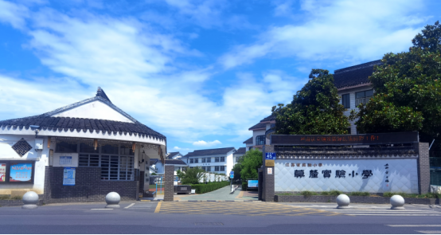
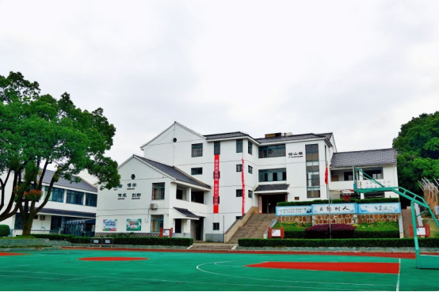

# 莫厘实验小学（紫金路校区）

本条落位指东山镇紫金路45号的紫金路校区；学校另有位于杨湾村、邻明善堂的幼山校区。本次已收集官网明确对应两校区的两张照片，紫金路校区校门照片可作本图幅建模参考，幼山照片单列防止混用。

## 位置

- WGS84（经度、纬度）：120.4017323, 31.0808522。
- 位置角色：OpenStreetMap紫金路校区学校用地多边形的面积质心；可信范围：中：官方简介与教育部门入学信息确认校区及地址，坐标和地块边界来自公众协作地图，未作测绘核验。
- 地址：江苏省苏州市吴中区东山镇紫金路45号（紫金路校区）。
- 2026-10-23重新读取OSM way/1327190550，标签amenity=school、name=江苏省实验小学莫厘实验小学；当时版本1，编辑时间2024-10-22T09:08:12Z。
- 以OSM节点坐标作平面多边形鞋带公式计算，先平移原点减少浮点抵消，得到[120.40173229978949,31.080852188614372]；本记录保留9位小数。
- 该坐标为紫金路校区校园地块质心，不是校门点，也不代表幼山校区。
- 紫金路45号据2022年吴中区教育部门入学服务信息；官网校门原图可辨45号门牌，可作相互核对。
- 幼山校区地址为东山镇杨湾村，官方简介称邻明善堂；本轮未为幼山校区填入未经核实的精确坐标。
- OSM地块范围约为经度120.4008254至120.4028678、纬度31.0799790至31.0817250；仅供后续边界核查。

## 客观信息

- 官方学校简介明确小学部由紫金路校区和幼山校区组成。（页面未注明发布日期；2026-10-23访问；[学校简介_学校概况_苏州市吴中区莫厘实验小学](https://dszxxx.wxedu.net/xxgk/xxjj)）

- 2022年吴中区小学入学服务信息列本部地址为东山镇紫金路45号，幼山校区地址为东山镇杨湾村。（2022年；[2022年吴中区小学入学服务信息](https://www.wxedu.net/old/xwzx/jcjy/zcfg/content_257426)）

- 官方简介记载紫金路校区占地13360平方米、建筑面积6065平方米；幼山校区占地5718平方米、建筑面积1791平方米。（页面未注明发布日期；2026-10-23访问；[学校简介_学校概况_苏州市吴中区莫厘实验小学](https://dszxxx.wxedu.net/xxgk/xxjj)）

- 官方简介称幼山校区位于杨湾古村、与明善堂为邻；该校区与本图幅紫金路校区不是同一处校园。（页面未注明发布日期；2026-10-23访问；[学校简介_学校概况_苏州市吴中区莫厘实验小学](https://dszxxx.wxedu.net/xxgk/xxjj)、[2022年吴中区小学入学服务信息](https://www.wxedu.net/old/xwzx/jcjy/zcfg/content_257426)）

- 官网简介第一张照片紧接紫金路校区段落，显示校门和45号门牌；第二张紧接幼山校区段落，显示篮球场及教学楼。（2026-10-23访问；拍摄日期未知；[学校简介_学校概况_苏州市吴中区莫厘实验小学](https://dszxxx.wxedu.net/xxgk/xxjj)）

## 参考图

### 紫金路校区校门（官网简介第一图）

- 类型/验证：从门前道路看校门及局部校园；已下载官网原图并目视核查；对应紫金路校区段落且门牌吻合；554×295像素；上传路径含2024/10/12，不能据此认定拍摄日期；SHA256 aea8e11e3e55ff9e99413150e84b7ef6e2ee2a16117e30f600e2bea6b3fbeba1。
- 左侧门卫建筑有白色山墙、深色瓦顶，外墙下部为深灰色。
- 右侧白色菱形纹理校名墙可辨“莫厘实验小学”；门柱有45号门牌。
- 入口铺装通向内部校园，后方可见白色多层建筑与树木。
- 无法由这一视角确定校园完整总平面、各楼栋高度或入口的精确方位角。
- [来源页面](https://dszxxx.wxedu.net/xxgk/xxjj) · [原图](https://dszxxx.wxedu.net/upload/dszxxx/contentmanage/article/image/2024/10/12/850359033d35461cb3de2404a28f9cfb.png)。
- 权利状态：官网标注学校版权所有；未确认开放许可，仅内部研究与建模参考，公开发布须另核授权。。

### 幼山校区篮球场与教学楼（官网简介第二图；异地校区对照）

- 类型/验证：幼山校区运动场地面视角；不能用于紫金路校区的建筑复原；已下载官网原图并目视核查；页面第二图对应幼山校区段落；554×369像素；上传路径含2024/10/12，拍摄日期未知；SHA256 f1a23120e924667dac2a3134e9b2da97391a7c6f1091240178438f2daf0c897a。
- 前景可见绿色篮球场、红色场区及篮球架。
- 背后为白色多层教学建筑，深色瓦顶；中央有通向二层的平台与台阶。
- 左侧大树遮挡部分教学楼，画面中可见校园绿化。
- 校区归属根据官方简介紧邻幼山段落的位置判定；不据此推算紫金路校区形态。
- [来源页面](https://dszxxx.wxedu.net/xxgk/xxjj) · [原图](https://dszxxx.wxedu.net/upload/dszxxx/contentmanage/article/image/2024/10/12/7bd04c1e6aa84d8eb376d75f02b0bf46.png)。
- 权利状态：官网标注学校版权所有；未确认开放许可，仅内部研究与建模参考，公开发布须另核授权。。

## 待补

- 紫金路校区缺航拍、带比例总平面及教学楼各向立面；现有原图分辨率较低。
- 校门精确WGS84坐标与朝向尚未核定。
- 幼山校区作为异地校区仅保存对照资料，未核定精确点位；不可套用本条主坐标。
- 官网简介未标注统计年份，面积为页面记载值，需与近期校园边界和建设变化复核。

[返回资料目录](../index.html#moli-primary-school)

## 附加源几何参考

[源地块与邻路平面图 SVG](../images/moli-primary-school-source-plan.svg)：北向上、米制比例尺；不是实景照片或测绘总平面。
