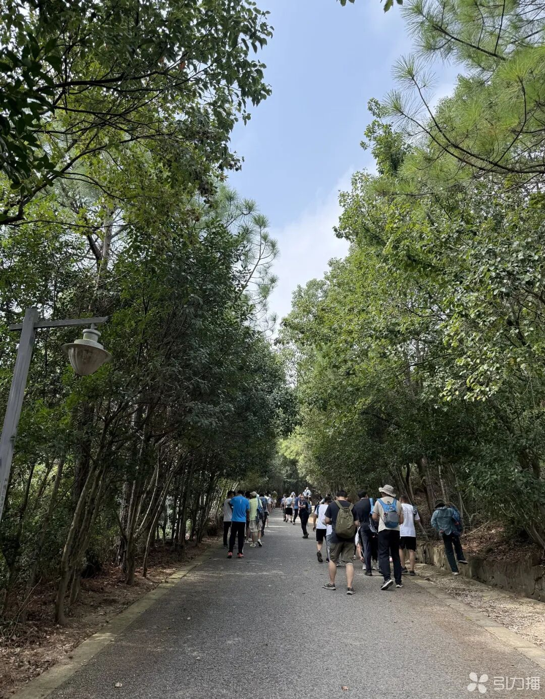
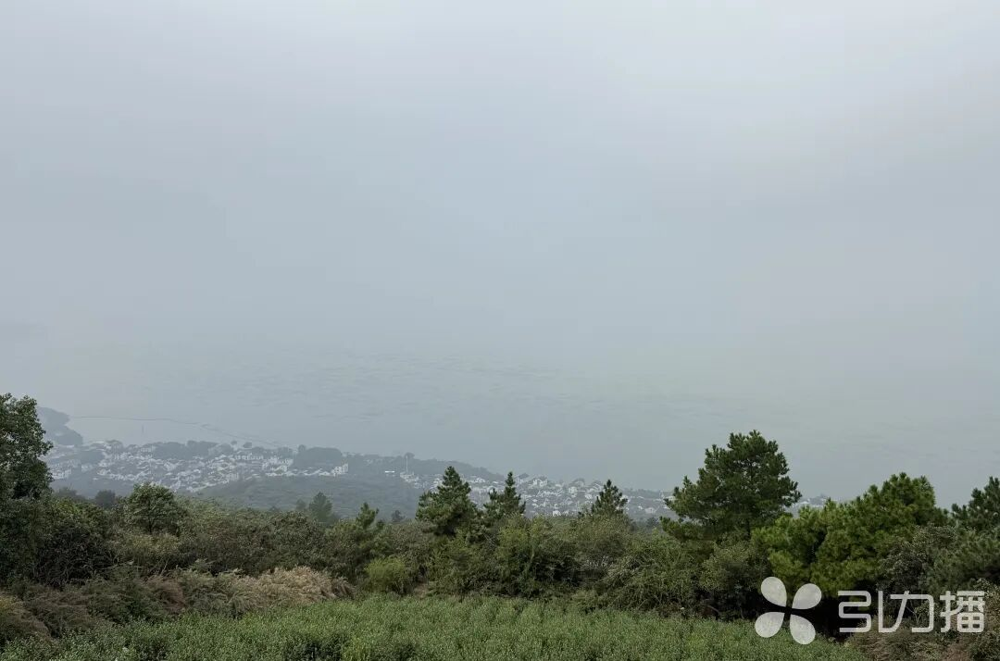

# 莫厘峰观景亭

OSM记录了莫厘峰观景亭点。官方近年报道另称莫厘峰近山顶有八角亭观景台，2021政府采购也记录八角亭周边林相改造；本批尚无证据证明这些名称对应同一座亭。已存点位及两幅步道、山顶视域环境照片。

## 位置

- WGS84（经度、纬度）：120.3872325, 31.0971525。
- 位置角色：OSM node/13800809431，tourism=viewpoint标签点；不是经测量的亭柱/台基轮廓；可信范围：中低：名称与坐标来自单一OSM点；八角亭名称、具体亭体对应待核验。
- 地址：江苏省苏州市吴中区东山镇莫厘峰山地（精确道路门牌不适用）。
- OSM原始标签direction=290，属观景方向信息，不能当作亭体旋转角或建筑朝向。
- 点来源于项目2026-10-19 OSM快照；坐标精度不代表现场测量精度。
- 2025年苏州日报报道和2021采购地块均可确认莫厘峰八角亭这个地物名称，但缺乏带坐标导览图或同景对照，故不将八角亭写入别名。
- 2021采购设计海拔215–265米属于亭周边林下改造地块范围，不能赋给OSM点作为亭基标高。

## 客观信息

- OSM将莫厘峰观景亭标为tourism=viewpoint，direction=290。（2026-10-19；[莫厘峰观景亭：OpenStreetMap node 13800809431](https://www.openstreetmap.org/node/13800809431)）

- 苏州日报2025年报道说莫厘峰接近山顶处有八角亭观景台，可眺望太湖；该描述尚不能证明它与本记录OSM点同一。（2025-10-08；[徒步莫厘峰郊野公园，太湖风光入画来](https://www.suzhou.gov.cn/szsrmzf/szyw/202510/f6ddb7f4edc749d18c8c86ba9cebdd81.shtml)）

- 2021年政府采购说明将八角亭林相改造地块置于莫厘峰南侧防火通道上坡、马尾松林下区域，地块约2万平方米，海拔215–265米、坡度20–40度。（2021-03-30；[东山镇莫里峰（八角亭）林相改造工程，项目SZJL2021-WZ-C-003（采购公告、成交与合同聚合页）](https://czju.suzhou.gov.cn/zfcg/html/project/1efd9c3abd3145b994924c03766392c2.shtml)）

- 同一采购设计提出在八角亭及大尖顶地块补植映山红；这说明当地地被和灌木可能包含有计划的人为营造，不能仅按自然群落假设。（2021-03-30；[东山镇莫里峰（八角亭）林相改造工程，项目SZJL2021-WZ-C-003（采购公告、成交与合同聚合页）](https://czju.suzhou.gov.cn/zfcg/html/project/1efd9c3abd3145b994924c03766392c2.shtml)）

- 苏州日报2026年图文中，署名朱雪芬的森林步道照片显示硬质步道、两侧边沟/路缘及针阔叶混合林；俯瞰太湖照片显示灌草前景、疏松树冠、山下聚落和湖面。两图均未出现可辨亭体。（2026-05-03；[五一来东山徒步，松弛感拿捏~](https://finance.sina.com.cn/wm/2026-05-03/doc-inhwrnpc1355306.shtml)）

## 参考图

### 莫厘峰森林步道环境（苏报融媒朱雪芬摄）

- 类型/验证：莫厘峰森林步道上的地面视角；图中未见亭体，具体机位未知；已下载并目视核验；报道图注明确莫厘峰森林步道；机位与OSM亭点未配准。
- 照片1080×1385，灰色硬质步道，两侧窄沟/路缘，游人可提供粗略视觉尺度。
- 可辨针叶枝条与阔叶树冠，林下局部裸地、落叶，树木非均匀网格。
- 不能仅凭照片精确鉴定全部树种或把道路宽度量化。
- [来源页面](https://finance.sina.com.cn/wm/2026-05-03/doc-inhwrnpc1355306.shtml) · [原图](https://n.sinaimg.cn/spider20260503/65/w1080h1385/20260503/9dcb-b73734793f4976e82cfa54dfe52c0cda.jpg)。
- 权利状态：朱雪芬/苏报融媒署名摄影，引力播水印；无开放许可，仅内部研究参考，不默认可公开贴图。

### 登顶莫厘峰俯瞰太湖（苏报融媒朱雪芬摄）

- 类型/验证：山上向太湖眺望；方位与具体机位未知；已下载并目视核验；图注明确登顶莫厘峰俯瞰太湖；非亭体照片。
- 照片1080×714，前景灌草及松形树冠，中景村落，背景为湖面。
- 有明显空气透视和雾霭；可用作山顶视域层次、植被覆盖的视觉参考。
- 图中没有亭体，不能用于认定八角亭/观景亭的形制、颜色和坐标。
- [来源页面](https://finance.sina.com.cn/wm/2026-05-03/doc-inhwrnpc1355306.shtml) · [原图](https://n.sinaimg.cn/spider20260503/194/w1080h714/20260503/60c2-7060cc48c1baa68677a0a6a1f922c0fc.jpg)。
- 权利状态：朱雪芬/苏报融媒署名摄影，引力播水印；无开放许可，仅内部研究参考。

### 游侠客莫厘峰线路页图像候选

- 类型/验证：待筛选的八角亭及沿线活动图；候选链接；未目视，不能作为可用亭体参考。
- 搜索索引提及到达八角亭观景台，页面含多幅图片。
- 直接打开为JavaScript应用壳，尚未建立图文对应，未下载或用作亭体依据。
- [来源页面](https://m.youxiake.com/lines.html?id=30131)。
- 权利状态：商业旅行页面，版权未核定。

## 待补

- OSM莫厘峰观景亭与官方八角亭观景台的同一性证据（带坐标导览图、定位现场照或可匹配航片）。
- 亭体近景/侧景、柱数、屋顶层数与形制、台基及护栏、材料颜色、约略尺度和朝向。
- 2021林相改造地块边界及现状映山红、马尾松覆盖；采购设计不能当作2026逐株现状。
- 两张环境照片的原始拍摄日期、机位与朝向（发布日期已知，EXIF位置未核验）。

[返回资料目录](../index.html#moli-viewing-pavilion)
