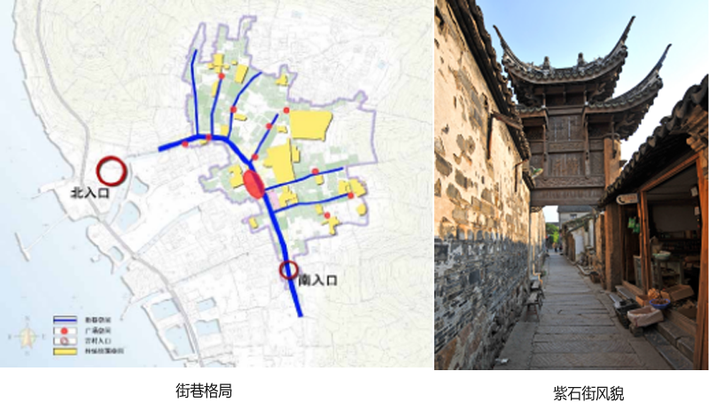
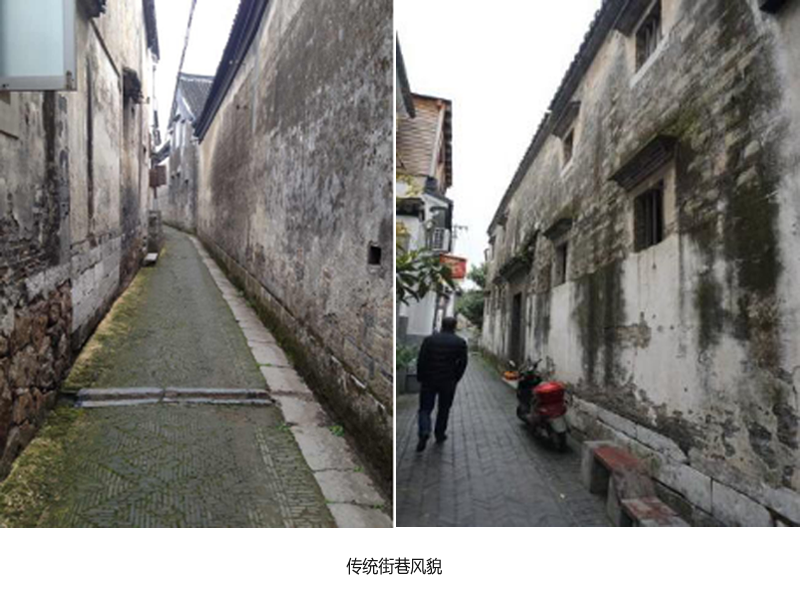
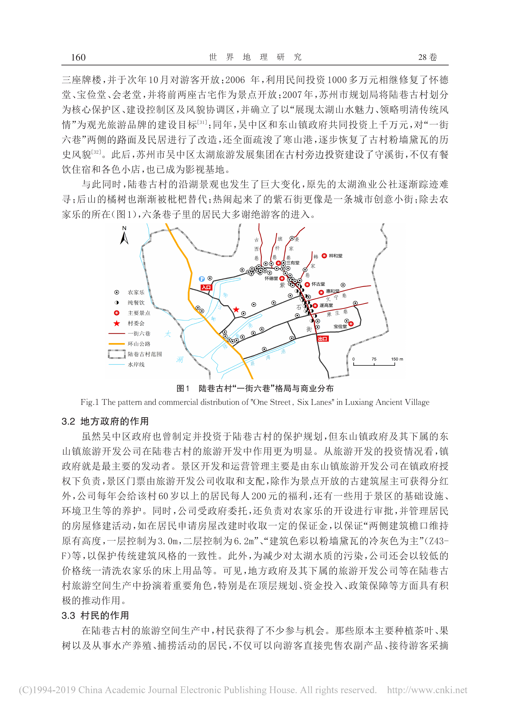

# 紫石街及三元牌坊组

陆巷古村的主街与道路枢纽，文献记为南北走向，与六条横巷组成街巷骨架。街上保留纪念王鏊科举经历的解元、会元、探花三座牌坊。

## 位置

- WGS84（经度、纬度）：暂未取得可靠数值坐标。
- 位置角色：街巷线及3个牌坊点；尚无测绘线形；可信范围：文献起讫与方向明确；现状线形、牌坊坐标待核。
- 地址：江苏省苏州市吴中区东山镇陆巷古村村落中心。
- 2020住建厅主办网页记：南起蒋湾浜场，北至寒山庵，呈南北走向；六条横巷在紫石街东侧，与其顺序相接。
- 同页列六巷为古西巷、旗杆巷、姜家巷、韩家巷、文宁巷、康庄巷；论文图1可辨这套骨架。
- 不得将陆巷入口牌楼、木构过街楼和三元石牌坊合并为同一对象。

## 客观信息

- 2020文献称紫石街始建于明代中期，南北向，长约里许、宽约2米；该尺寸是文献概述，不作为全街恒定净宽或2026实测。（2020-08-21；[苏州市东山镇陆巷村陆巷](https://www.c-dwellings.com/news_detail.php?id=380)）

- 主街与其东侧六条横巷组成“一街六巷”格局，是古村道路枢纽。（2020-08-21；[苏州市东山镇陆巷村陆巷](https://www.c-dwellings.com/news_detail.php?id=380)）

- 地方志列紫石街上的三座牌坊为解元、会元、探花，纪念王鏊的科举经历。（2026-09-24；[古镇古村系列——吴中区陆巷村：太湖明珠，宰相故里](https://dfzb.suzhou.gov.cn/dfzb/szdq/202609/74f82b260f3045e79aeb1cb2c5d0d15d.shtml)）

- 2026地方志记保护整治曾修复紫石街及六条古巷，并修缮三座明代牌坊；当前可见状态含保护修缮成果。（2026-09-24；[古镇古村系列——吴中区陆巷村：太湖明珠，宰相故里](https://dfzb.suzhou.gov.cn/dfzb/szdq/202609/74f82b260f3045e79aeb1cb2c5d0d15d.shtml)）

- 旧参考图04可见石板路、连续墙面和牌坊，牌坊正面可辨“解元”字样；该图仅覆盖单处牌坊局部。（影像拍摄日期未注明；[古镇古村系列——吴中区陆巷村：太湖明珠，宰相故里](https://dfzb.suzhou.gov.cn/dfzb/szdq/202609/74f82b260f3045e79aeb1cb2c5d0d15d.shtml)）

- 论文图1带北箭头、0–150 m比例尺，可读主街与巷道、港道、环山公路的相对关系；未绘出三座牌坊的逐个可靠坐标。（2019-12；[社区参与模式下的传统村落旅游空间生产及影响初探——基于苏州东山陆巷古村的调研](https://faculty.ecnu.edu.cn/_upload/article/files/71/c0/cdbcd566457b8af90879d23f0447/dcad72f2-4050-4e57-93ad-e668ac1c7f50.pdf)）

## 参考图

### 紫石街石板巷道与牌坊

- 类型/验证：紫石街局部／解元牌坊正面；2026-10-23复核来源页并重新目视本地原图；复用旧参考包，不重复下载。。
- 石板巷道、连续墙面、门廊和跨街石牌坊；牌坊字样可辨为“解元”。
- 单幅透视不能量测巷宽；未包括会元、探花两坊完整立面，也未给三坊间距。
- [来源页面](https://dfzb.suzhou.gov.cn/dfzb/szdq/202609/74f82b260f3045e79aeb1cb2c5d0d15d.shtml) · [原图](https://dfzb.suzhou.gov.cn/dfzb/szdq/202609/74f82b260f3045e79aeb1cb2c5d0d15d/images/6ada305ed88a48a79e457a6a3e8a10b2.png)。
- 权利状态：未确认开放许可；保留原署名/水印，仅作内部研究参考，不据此视为可公开贴图或再分发。。

### 陆巷街巷格局图及过街楼照片

- 类型/验证：街巷格局示意图与窄巷过街楼照片组合；2026-10-23已核对来源上下文、下载原图并目视检查；无登录/错误页。。
- 左图以蓝色突出主巷骨架，标北入口、南入口与若干节点；可比对街巷与滨湖一侧的关系。
- 右图是跨巷的木构过街楼，不能替代解元、会元、探花三座石牌坊的造型证据。
- 组合图无坐标、可读比例尺，不能据此直接定位WGS84顶点。
- [来源页面](https://www.c-dwellings.com/news_detail.php?id=380) · [原图](https://www.c-dwellings.com/images/article/237_content_1598005519032377.png)。
- 权利状态：未确认开放许可；保留原署名/水印，仅作内部研究参考，不据此视为可公开贴图或再分发。。

### 陆巷传统街巷风貌（两幅）

- 类型/验证：村内窄巷实景；2026-10-23已核对来源上下文、下载原图并目视检查；无登录/错误页。。
- 可见高墙围合的窄巷、石板/石条路缘、门窗与局部坡阶，可作街巷材质和空间比例参考。
- 原图未逐幅标明确切巷名，不能将两幅都确定标为紫石街，也不能以行人推算精确宽度。
- [来源页面](https://www.c-dwellings.com/news_detail.php?id=380) · [原图](https://www.c-dwellings.com/images/article/237_content_1598005702352223.png)。
- 权利状态：未确认开放许可；保留原署名/水印，仅作内部研究参考，不据此视为可公开贴图或再分发。。

### 陆巷古村“一街六巷”格局与商业分布（论文图1，完整第160页）

- 类型/验证：PDF第5页渲染；图1及上下文；2026-10-23下载PDF；用Poppler渲染并目视完整第1页和第5页，核实标题、作者、图1、北箭头及比例尺。。
- 图1有北箭头和0–150 m比例尺；红线标一街六巷，蓝线标水岸，橙线为环山公路。
- 可辨紫石街、文宁巷、康庄巷及惠和堂位置；村落西侧为太湖，三个港道分别通向湖侧。
- 这是2019论文中的示意地图，未给CRS、基准点或测绘精度；可做历史相对空间关系，不输出精确WGS84线形。
- [来源页面](https://faculty.ecnu.edu.cn/_upload/article/files/71/c0/cdbcd566457b8af90879d23f0447/dcad72f2-4050-4e57-93ad-e668ac1c7f50.pdf)。
- 权利状态：未确认开放许可；保留原署名/水印，仅作内部研究参考，不据此视为可公开贴图或再分发。。

## 待补

- 主街准确起讫点、2026现状中心线与转折点。
- 解元、会元、探花三坊逐座坐标、实际排列与间距。
- 三坊正面/背面/侧面完整清晰照片和构件尺寸。
- 文献“约里许”的长度解释与现存可游览路段长度。

[返回资料目录](../index.html#zishi-street)
