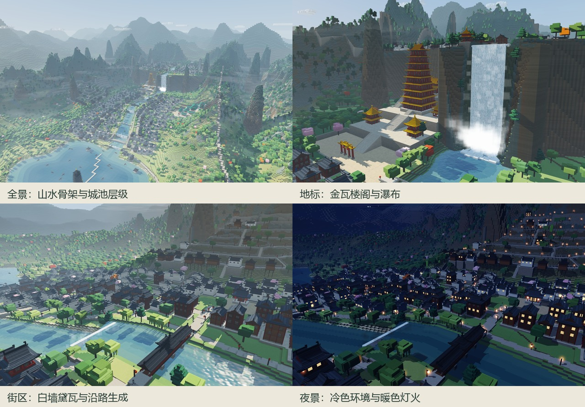
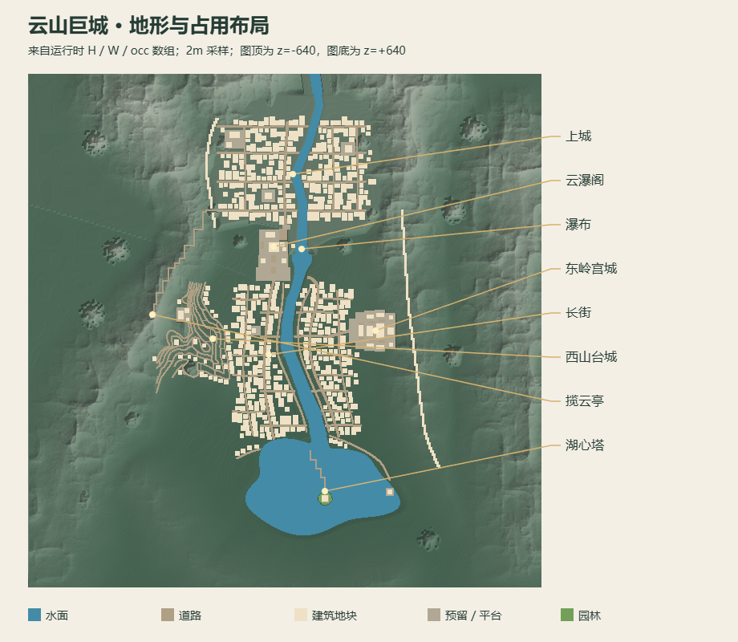
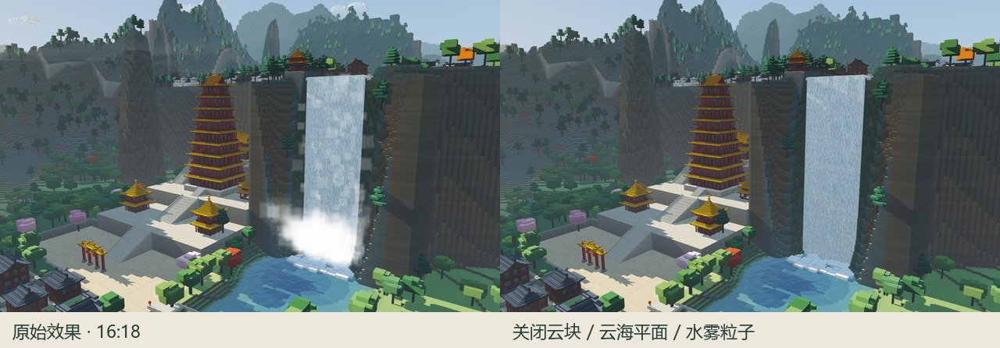
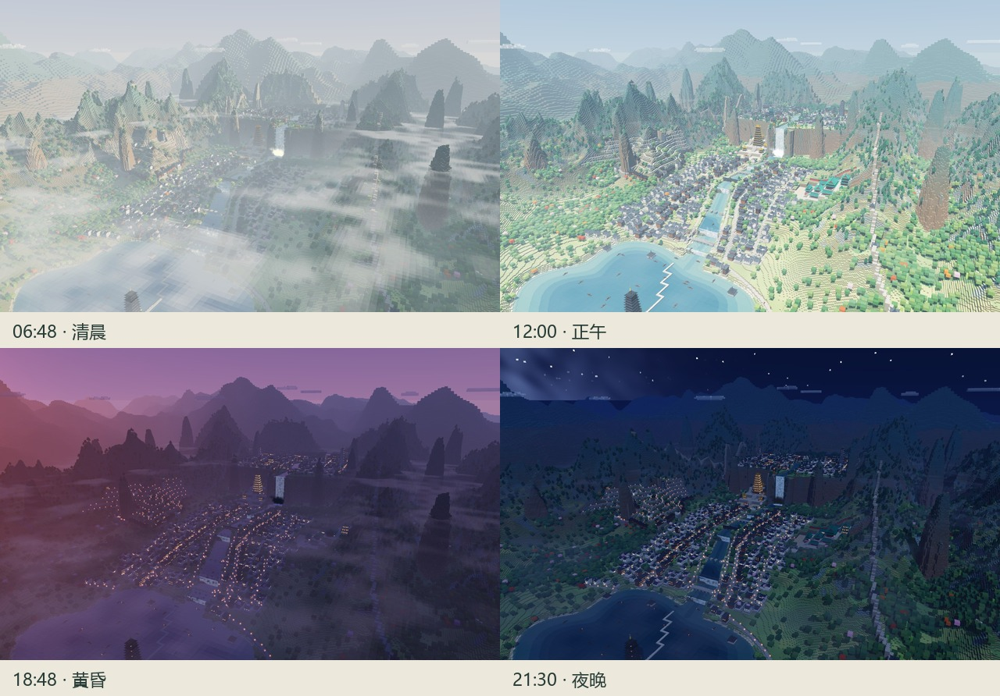

# 《云山巨城》深度解析与仿作指南

**这件作品最值得学习的，是一套“手工组织山水骨架，规则生成城池细节，再用统一光照与雾组织观看”的方法**。它的风格可以概括为：中式幻想山城、带青绿设色倾向的体素景观，以及具有叙事作用的昼夜与游览镜头。

本档案分析用户提供的 `云山巨城.html`：196,020 字节、3,783 行。原附件未修改；`source/云山巨城.html` 是逐字节一致的备份。本文的 L 行号及专题笔记均对应这份原文件。

分析分三种依据：**源码事实**说明确切实现；**画面观察**来自本次实际渲染；**仿作建议**是从二者提炼的学习方法。本文不推断原作者身份、制作过程或特定历史原型。



## 1. 先建立准确的认识

| 容易产生的印象 | 源码和画面支持的判断 |
| --- | --- |
| 一个普通 HTML 页面 | 页面外壳是 HTML/CSS，主体是一套运行时生成城市的原生 WebGL2 程序，11 个逻辑分区、6 组着色程序 |
| 全城由 0.2 米小立方体构成 | 建筑坐标按 0.2 米量化；主地形是 1 米二维高度场；近距表面格纹又由 shader 补充；不是完整三维体素数据库 |
| 纯水墨或国画算法 | 青绿山色、层叠雾和书法印章提供山水联想；实际采用彩色光照、透视相机、硬边盒状几何，未见墨迹扩散或纸纹算法 |
| 一份严格的古建筑复原 | 白墙黛瓦、马头墙、红柱彩梁、重檐等母题可辨；传统构造被压缩为几何符号，不能据此学习完整营造结构 |
| 完全随机长出的山城 | 山脊、水系、台地、重要街道与地标由明确坐标设计；随机主要丰富尺寸、间距、树冠与窗灯 |
| “低多边形”意味着几何很少 | 单体形状简单不代表全城面数少；大型高度场与大量构件仍需分块、合并、剔除和 LOD |

最有用的区分是：**体素风格是一种造型与采样语言，体素数据结构是一种存储方法。**本作主要使用前者。

证据入口：地形 L340、L525；网格 L723；建筑 L958；主 shader L2791；渲染器 L3021；相机 L3458。

## 2. 美术风格为什么成立

### 2.1 远景看山水，近景看构件

全景里，密集住宅连成灰白纹理，山体逐层趋向蓝灰天空色；湖面和河流提供连续的开阔区。近景里，台阶屋顶、方形树冠、窗格、腰檐和地坪块纹清晰可见。

因此仿作要同时维护两种尺度：远看时有大轮廓、疏密和层次；近看时有一致的盒状构件和建筑类别。只增加方块细节，难以获得前一种效果；只加厚雾，也难以建立后一种效果。

### 2.2 普通街区统一，地标分级突出

大量民居用暖白墙、暗灰瓦、褐色木构形成稳定底调；云瀑阁集中使用红楼身与黄瓦，宫城使用绿瓦，白瀑又形成最强的亮度焦点。地标的辨认同时依赖颜色、高度、空隙与台基。

这里的“青绿倾向”有直接代码证据：高处草地逐渐混入石绿 `malachite`，岩石混入玉青 `jade`，崖壁从褐色过渡至青色（L846–879）。但本次下午截图中的部分树木、草坡和红绿建筑相当鲜亮，不能把全片概括成低饱和。

| 材料角色 | 源码固有色 | 学习重点 |
| --- | --- | --- |
| 民居墙与瓦 | 墙 `#E7E2D4`；瓦 `#3C434B` | 用明暗重复统一街区 |
| 日常木构 | 木 `#5B3B2A`；暗木 `#3D2A20` | 给店铺、柱与栏杆一个共同色域 |
| 地标暖色 | 柱 `#9A3322`；黄瓦 `#D49A2A`；金 `#DCAE48` | 集中于少数重要建筑 |
| 宫城与彩梁 | 绿瓦 `#2E7B66`；梁 `#2F6079` / `#3D8A7B` | 形成与黄瓦阁不同的区域身份 |
| 高山与岩壁 | 玉青 `#4D7F78`；石绿 `#5A9468`；高崖 `#587A78` | 随高度递变，避免全山一种绿 |
| UI | 纸 `#EFE7D6`；朱印 `#B3422C`；玉绿 `#7FB08A` | 将界面语言与场景文化语义接在一起 |

这些是材质输入值，并非截图取样值。光照、雾、色调映射和输出变换都会改变最终颜色。仿作应分别管理“物体是什么颜色”与“环境怎样照亮它”。

### 2.3 轮廓先承担建筑辨识，装饰再补语义

| 类型 | 缩略图中应保留的签名 | 函数 |
| --- | --- | --- |
| 民居 | 白墙、灰顶、马头墙 | `houseHui` L1142 |
| 院落 | 前后屋、侧墙、中间留空 | `courtyardHui` L1178 |
| 商铺 | 深色首层、上层挑台、招幌灯笼 | `shop` L1198 |
| 吊脚楼 | 下伸柱脚、外挑楼板 | `stiltHouse` L1239 |
| 殿堂 | 大台基、横向体量、红柱、重檐 | `hall` L1257 |
| 楼阁 | 多层腰檐、平座、逐级收小 | `tower` L1307 |
| 亭 | 小体量、开敞柱间、尖顶 | `pavilion` L1346 |
| 塔 | 细长塔身、密集短檐、塔刹 | `pagoda` L1371 |
| 牌坊 | 跨路柱列、三组小顶 | `paifang` L1405 |

屋顶是最值得单独练习的构件。它不是光滑曲面，而是每层高 0.2 米的水平盒层；横向缩进采用非线性 `pow(i/nL, 0.62)`，并以不同 x/z 收缩规则近似双坡、歇山、四坡和攒尖（L980–1057）。角部另叠上扬短块，形成飞檐。

这是一种“压缩识别特征”的建模方法。殿堂的所谓斗拱彩画实际上是整片彩色盒层与细带（L1283–1286）；塔的拱门/窗用长方块表达（L1382–1387）。应学习其视觉表达效率，同时看清简化边界。

## 3. 空间架构：地形与城市互相生成

下面这张俯视图从运行时 `H`、`W`、`occ` 数组生成，采用 2 米采样。浅色块表示建筑占用地块，并非屋顶实测轮廓；景点标注采用源码预设视角目标与瀑布定义。它是虚构场景的世界坐标示意，不是现实地理地图。



大体关系可以读成一条逐步上升的空间序列：湖岸与码头 → 两岸低城 → 云瀑阁的层台 → 崖壁天梯 → 上城 → 西门山径 → 峰亭。宫城和西山台城各自成为侧向分支。

| 区域 | 组织方式 | 产生的视觉作用 |
| --- | --- | --- |
| 湖与下游河道 | 源码控制湖盆、河流曲线和逐段水位 | 为密集城屋留空，并引出纵深 |
| 下城 | 两岸长街、滨河路、横巷、桥梁 | 形成连续生活街区 |
| 云瀑阁 | 48/56/64/76 米平台、九层主阁、邻接大瀑 | 把建筑层级与地形层级叠加为焦点 |
| 主瀑与上城 | 主瀑从 123 米落至 44 米；上城台地基准 126 米 | 用强高差建立宏大感与上下城分界 |
| 西山台城 | 顺等高线追踪巷道，再用侧向台阶相连 | 表现顺坡生长的街区 |
| 东岭宫城 | 多级台基与中轴门殿阁序列 | 通过对称、间距与台基表现等级 |
| 远山 | 主世界外延至 ±2400 米，采用较粗几何 | 保持全景尺度，弱化边缘暴露 |

对应代码：地理 L351–389；各片区 L1919–2298；西山等高线 L2140；远山 L2633。

**可迁移的原则：大关系由设计决定，小差异由程序补充**。固定山水与几个地标后，再用道路规则放房子，用占用检查避免冲突，用挖填限制或吊脚楼处理高差。换一个随机种子只能改变局部变体，不能替代重新设计构图。

## 4. 程序架构与数据流

全文件 JavaScript 在一个立即执行函数内。`util.js` 等名称只是注释分区，并没有实际 `import/export` 模块。`window.YS` 是公开的调试入口（L3777）。

| 分区 | 源码范围 | 核心职责 |
| --- | --- | --- |
| util | L154–338 | 数学、随机、噪声、路径、矩阵 |
| world | L339–717 | 地形高度、水位、材质、占用和改造 |
| mesh | L718–957 | 四边形、盒子、局部坐标、地形/水网格 |
| arch | L958–1436 | 建筑调色板、通用构件、各建筑类型 |
| city | L1437–2384 | 道路、台阶、地块、桥、墙、片区与路线 |
| flora | L2385–2525 | 植被分布及近远树形 |
| atmos | L2526–2661 | 云、云海、水雾、灯晕、远山 |
| env | L2662–2750 | 时刻到光照、天空、雾、灯火的转换 |
| render | L2751–3288 | GLSL、GPU 上传、阴影与分阶段绘制 |
| scene | L3289–3373 | 分块、LOD、绘制列表 |
| app | L3374–3779 | 启动、相机、UI、主循环与抓帧 |

启动顺序（`boot` L3383）非常重要：

```text
地理控制点 + 噪声
        ↓
World：自然高度 / 当前高度 / 水位 / 材质 / 占用
        ↓
City：修平台与道路 → 放地标 → 约束地块填充
        ↓
补挡土墙 → 植树 → 生成远景 LOD / 高度纹理
        ↓
MeshBuilder / Frame：主结构网格 + 细节网格
        ↓
Scene：64 米分块与绘制列表
        ↓
Renderer ← Camera + computeEnv(hours, clock)
        ↓
最终画面；UI 回写时间、相机与游览状态
```

`World` 的 `nat` 保留自然地形，`H` 记录城市改造后的地表；`occ` 用占用码让路、房、水、保留区和园林彼此避让。植物必须在城市改造后放置，高度纹理与远景 LOD 也必须基于最终地表生成。顺序颠倒会产生树穿建筑、水深不匹配或远近地表不一致。

`City` 将规划与网格发射放在一起，启动后上传建筑并释放 `builders`（L3435）。因此当前结构适合静态展示，尚不是可编辑城市引擎。若要发展成学习项目，应先保存建筑 ID、配置和位置，再由几何层生成网格。

## 5. 从几何到画面：风格实际在哪些层产生

### 5.1 几何层：较粗大形与精细量化并存

主地形每格只有一个高度，适合坡地、崖壁、台地；洞穴和悬空岩桥需要额外网格。地形只发出顶面和暴露的高差侧面，部分连续顶面沿行合并；它不是把每个地表格做成独立 JS 对象。

建筑用 `Frame` 将局部坐标写入世界坐标，仅支持四个直角朝向。主结构与细节分开写入，远处可以省略栏杆、窗格或翘角。顶点保存位置、颜色、AO 和行为标记，总共 20 字节（L719、L3081–3084）；法线只保存六个轴向编号。

### 5.2 材质层：表面细节大多来自坐标计算

本作未导入模型或颜色纹理贴图。瓦纹、岩层、石块错缝、方格颗粒、瀑布条纹和灯窗由顶点颜色及 shader 生成。

| 效果 | 生成方法 | 行号 |
| --- | --- | --- |
| 近距体素颗粒 | 世界坐标乘 5，取格子哈希扰动颜色；边缘轻微变暗；远处淡出 | L2814–2821 |
| 屋瓦 | 顶面与 ROOF 标记触发奇偶纹路 | L2822 |
| 岩层 | 高度行与横向低频哈希 | L2823 |
| 砌石 | MASON 标记、错缝行列、灰缝暗化 | L2824–2833 |
| 瀑布 | 固定几何上移动纵向随机色段 | L2836–2844 |
| 灯窗 | 发光强度、随机亮窗阈值、时间闪烁 | L2859–2872 |

这解释了一个重要现象：**看上去很多小块，并不意味着全部小块都被建模**。把高频细节交给着色，把主要轮廓留给几何，是这件作品的关键策略。

### 5.3 光照与大气层：用近似组织可信的观看

基本着色可读成：固有色 ×（方向主光 × 阴影 + 天地环境光 × AO）+ 自发光，再经过雾、ACES 风格色调映射、饱和度调整与 gamma 输出。这不是完整 PBR 或全局光照系统。

| 画面效果 | 真实实现 | 不应误解成 |
| --- | --- | --- |
| 山雾与空气透视 | 高度衰减的视线雾积分，叠加远距 haze | 完整体积散射模拟 |
| 云海 | y=46 和 y=148 两层平面，噪声及遮罩控制透明度 | 三维云海体积 |
| 块云 | 椭球团合成局部占用，仅生成外露方块面，整体移动 | 气象模拟 |
| 波水 | 固定水面、噪声法线、深浅色、Fresnel 天空反射 | 物理流体或完整城市镜面反射 |
| 水中灯火 | 按附近水位分组，将点精灵 y 坐标镜像 | 建筑与山体的反射贴图 |
| 主瀑 | 静态水帘盒子 + 移动色纹 + 方形柔边水雾粒子 | 流体求解 |
| 灯笼柔晕 | 自发光与加色点精灵 | 后处理 bloom 或真实局部灯光照明 |

渲染顺序为：主光阴影 → 天空 → 不透明物体 → 水 → 倒影灯晕 → 块云 → 云海 → 水雾 → 灯晕（L3134–3285）。这是学习透明混合和效果分工的好例子。

以下对照只关闭块云、云海平面和水雾粒子，常规空气透视仍然保留：



## 6. 昼夜与镜头也是美术系统



本作有两个独立时钟：`hours` 控制一天内时刻；`clock` 控制云水、瀑布、星光和灯火动画。暂停时间只停止前者，所以夕阳可以保持，水和云仍继续运动（L3718–3719）。

太阳方向采用固定纬度与赤纬，再根据太阳高度插值人工设计的天空、主光、环境光和雾色。清晨 6.8 时附近加强雾，夜晚提高曝光并点亮灯窗。这是艺术化昼夜，不是针对某日期、某地的精确天文模型。

同一相机的对照显示：白天靠白墙、屋顶和树冠理解空间；黄昏与夜晚靠沿街灯点和窗口重新理解路线。仿作时，昼夜不应只改变天空背景色。

“自由观景”实质是绕目标点的 orbit 相机。八个预设视角分别定义目标、角度和距离，飞往景点时有缓动与抬高。全景相机使用 50° 透视视场，游览使用 62°；并非正交轴测或传统散点透视。

导览采用作者指定路径，不是导航网格寻路。它把道路、台阶和山径接起来，按弧长推进，并在某些路段把视线逐渐引向地标（`attn` L3515）。“路线”和“看向哪里”分开配置，是很值得继承的叙事结构。

## 7. 大场景如何组织，以及仿作时的限制

| 策略 | 实际做法 | 学习意义 |
| --- | --- | --- |
| 分块 | 64 米一块，20×20 共 400 块 | 让网格生成、上传和距离管理有边界 |
| 近远 LOD | 近地形 1 米、远地形 2 米；近远树分别建模 | 先保住远景轮廓，再补近景构件 |
| 滞回 | 250 米内建立近块，330 米外释放 | 避免距离阈值附近反复切换 |
| 生成预算 | 普通帧最多新建 2 个近块 | 分摊生成工作，但每块仍是同步构建 |
| 细节距离 | 360 米内绘制建筑细节，200 米内纳入其阴影 | 视觉重要性与开销共同分级 |
| 阴影 | 一张随焦点移动的 4096² 深度图；部分硬件回退到 2048² | 范围和清晰度需要取舍 |
| 分辨率反馈 | 90 帧均值决定 DPR 上限，在 1.5 至 0.66 之间切换 | 速度与画质一起记录，避免误判流畅度 |

一次运行读到的规模：建筑放置计数 `nBuild=584`、道路记录 48 条、树木记录 12,846 个、块云 12 组、水雾点 1,100 个。`nBuild` 是两种放置函数的计数，不包含所有独立构件，也不把一个院落内的子建筑逐栋统计。这些数据体现规则扩展规模的能力。

最终截图运行的生成阶段记录约 1.86 秒，使用 Chrome 无界面模式与 SwiftShader 软件 WebGL；该值不含渲染器初始化，不能推断用户显卡上的加载速度。检查了视角抓帧、四个导览站点、模式切换、时间滑条和 390 像素手机布局；所检步骤未发现 JavaScript 异常，检查点的 `gl.getError()` 为 0。未做持续帧率、全路线碰撞或真实手机硬件测试。

迁移代码之前，特别留意：

1. `snap`、格纹、水纹和许多构件同时写死 0.2 或 5，不能只改 `VOX`。
2. 水与雾 shader 写死 640/1279，城市、相机、路线采用固定坐标，不能只改 `WN/WH` 缩地图。
3. 规划与几何烘焙耦合；修改地形后要同步高度纹理、网格与 LOD。
4. 道路点有 `[x,z,y]` 约定，导览点是 `[x,y,z]`；提取时应统一坐标类型。
5. 相机主要避地面，未实现完整建筑碰撞；暂停日夜也不暂停所有动画。
6. 透明排序、灯反射水域裁剪、上下文恢复与完整资源释放仍有扩展空间。它适合学习展示场景，进一步做编辑器需要补这些系统。

## 8. 从哪里读源码最有效

不必按 3,783 行从头背到尾。按一个可见问题追踪一条依赖链，更容易建立理解。

| 想理解的问题 | 建议阅读链 |
| --- | --- |
| 一座房子怎样长出来 | `PAL` L960 → `houseHui` L1142 → `roof` L980 → `Frame` L804 → `MeshBuilder.box` L777 |
| 为什么房子沿路排列 | 建筑组合 L1907 → `lotsAlong` L1649 → 地块检查 L676 → `placeBuilding` L1694 |
| 山城的大形从哪里来 | `RIDGES` L351 → `ridgeHeight` L419 → `macroFrom` L468 → `carveHeight` L487 → `World.generate` L552 |
| 小块细节为何很多 | 顶点标记 L720 → `FS_MAIN` L2791 → 格纹 L2814 → 石纹 L2824 |
| 为什么远山会变淡 | `computeEnv` L2698 → `applyFog` L2770 → `finish` L2781 |
| 为什么昼夜仍有水动 | `App` L3375 → `frame` L3717 → 环境 L2698 → 瀑布/水 shader L2836、L2930 |
| 为什么导览会看向地标 | `assembleTour` L2359 → `initTour` L3492 → `attn` L3515 → `tourStep` L3535 |
| 大城为什么能分批显示 | `Scene` L3293 → `update` L3344 → `lists` L3359 → `Renderer.render` L3134 |

原文件自带抓帧入口。待 `YS.ready` 后，在浏览器控制台执行下面几行，可以固定云瀑阁机位、下午时刻，并补齐近景块；最后一行返回画布 JPEG 的数据 URL：

```js
YS.playing = false;
YS.fly = null;
YS.snap({ view: 1, hours: 16.3 });
YS.scene.update(YS.cam, 400);
YS.snap({ view: 1, hours: 16.3 });
```

以 `?test=1` 打开原作会停止自动帧循环，因此手动改完状态需调用 `YS.snap()` 才有新画面。这个模式适合学习对照；普通打开的界面会持续更新。

读代码时以实现为准：远山注释写 16 米，实际 `S=12`（L2634）；主瀑注释写三层，但主体是主盒条带加概率前层，局部 `layers` 数组未使用（L1984–1989）；`landmarkTop` 也是记录值，不能直接作为含所有腰檐与屋顶的精确阁高。

## 9. 分阶段学习与仿作

建议第一件独立作品是 **160–240 米构图区内的一段溪湾：6–10 间民居、一桥一亭、两层山体、三组树**。这是新场景的设计范围，不是让你直接把原作世界常量改成 240。

| 阶段 | 练习 | 验收重点 |
| --- | --- | --- |
| 1. 固定画面观察 | 比较本档案全景/近景、同机位日夜 | 能说明主景、留白、明暗和远近分别由什么产生 |
| 2. 屋顶实验台 | 同基底比较 `gable/xs/pyr`；试坡度和起翘 | 缩小后仍能从轮廓分辨，构件属于同一种语言 |
| 3. 一间民居 | 组合台基、墙、马头墙、屋顶、门窗；做三个变体 | 明暗层级一致，变化来自尺寸与比例 |
| 4. 一段街区 | 先手摆，再加入有限随机与地块检查 | 朝向道路，密疏有节奏，建筑不悬空、不挤满所有空隙 |
| 5. 小型山水 | 两层山、弯水、桥、三组树 | 灰度缩略图里主景仍清楚，前中后景可分 |
| 6. 大气与夜灯 | 独立调天空、雾、灯、曝光；比较四时 | 夜景有暗部和路线，雾增强层次并保留主体 |
| 7. 镜头与规模 | 加几个景点和短导览，再学习分块与 LOD | 每个视角都成立，性能记录同时包含画质 |

每阶段只改一组因素，保存同一相机与时刻的对照。先让十间房子的关系成立，再让规则生成几百间。

## 10. 仿风格时，保留什么，重新设计什么

**值得保留的规则：**多尺度量化；建筑类别的轮廓签名；普通街区统一、地标有限强调；山色随高度变化；树与道路水岸相互避让；近景繁、远景简；空气透视与冷暖灯火；路线和视线分开设计。

**应重新设计的内容：**主景位置、河流走向、山体轮廓、建筑数量与高度、主要留白、进入场景的视角，以及游览顺序。不要把所有原作地标同时搬入新场景。

三个可用的练习题：

- **溪湾横卷：**以低层两岸民居为主，小桥在侧，远处一亭，水面留空；练重复与疏密。
- **山口层城：**聚落沿两三级台地上升，主景偏画面一侧，松树和岩壁围出另一侧；练高差与框景。
- **湖岛夜渡：**减少建筑，以水榭、船、码头、柳树和集中暖灯为主；练留白与夜景冷暖。

如果新作与原作的灰度缩略图仍有几乎相同的主景位置、河流方向和山体大轮廓，说明仍主要在复制构图。如果大关系已不同，而轮廓、材质、雾与光照的语法相通，就更能证明学到了风格规则。

### 未来代码组织建议

将世界尺度、山脊/河流、建筑类型、片区规则、环境、相机、导览分别配置。先保存城市计划，再把计划生成几何；随机按片区和建筑派生独立种子，减少增删对象对后续结果的连锁影响。

```text
配置数据 → 地形数据 → 城市计划 → 构件几何 → 场景分块 → 渲染
                 ↘ 用地与地表约束 ↗
相机 / 时刻 / 导览 → 每帧状态与统一环境参数
```

若继续沿原生 WebGL2 路线，可优先提取量化、颜色、随机、`MeshBuilder/Frame`、`roof` 与一种建筑，再建立最小渲染层。若在其他三维引擎中复现，也可以继承构图与几何规则，但应重新匹配色彩空间、雾、阴影与色调映射，不能预期默认渲染设置产生同样画面。

## 11. 专题笔记与证据

- [美术风格详解](notes/01-美术风格详解.md)：更完整的色表、建筑语法、空间角色、氛围与画面观察。
- [程序架构详解](notes/02-程序架构详解.md)：数组、算法、网格、着色器、绘制阶段、相机和维护边界。
- [学习与仿作练习](notes/03-学习与仿作练习.md)：阶段验收、参数对照与不同构图方案。
- [原作备份](source/云山巨城.html)：与附件字节一致，可普通打开体验。
- [运行证据](runtime-evidence.json) 与 [交互证据](interaction-evidence.json)：保留环境、计数和检查结果。

`images/` 内有 17 张单图，包括八个景点、昼夜、桌面及手机界面、局部大气关闭对照、俯视布局，另有 3 张对照拼图。全部场景图来自实际代码渲染；没有使用 AI 重绘。截图统一采用本地字体回退，因此与联网加载书法字体时的界面字形可能不同。

截图脚本保存在 `scripts/`，依赖本机 Chrome、Playwright、Python/Pillow 与当前运行时路径；它们用于复核这次分析，不是已经搭好的通用仿作框架。

来源文件 SHA-256：`afc7dbc36f16b9300679956ca4ef8130afae298ecd4528a792ddcd2a5c3894aa`。
